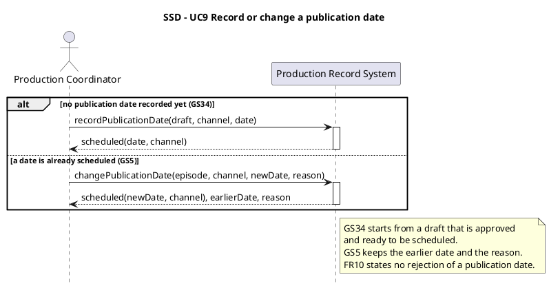
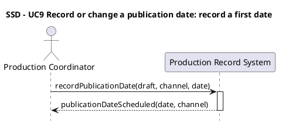
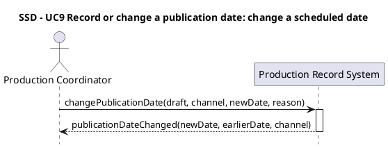

# Group AI Declaration
The group used generative AI as a supporting tool. Tools: Claude (Rani), Perplexity (Arno), Copilot (Jack), Claude (Tsubasa). Affected artefacts: section files A–D, SSDs, operation contracts, CRC cards and GRASP notes, UC2 interaction diagrams, decision-log entries, review comments and issue descriptions. All AI-supported changes to the shared design were reviewed by at least one other member and agreed through GitHub issues or the decision log. Individual declarations follow.

# Tsubasa Hirose
## AI Declaration
- AI was used for English translation, review and critique, questions about structure, and locating relevant passages in the course references (Sessions 9–14, the Session 11 laboratory workbook and the CA2 brief). 
- AI reviewed my SSDs (UC8–UC10), operation contracts (OC01–OC04), CRC cards and GRASP rationale against the course references, and pointed out inconsistencies between them.
- For some items, AI also suggested corrected examples (PlantUML fragments, contract wording) and design options. One example is the choice of how to represent blocked drafts, per-channel outcomes, scheduled versus published publications, and the publication-date history. I chose among these options and recorded the choices as decisions. They were then reviewed by the group through pull requests.
- AI was used for coding support with GitHub: preparing commits and pull requests, including git and `gh` commands, commit messages and pull-request descriptions. I checked each change before it was committed or pushed.
- AI was used to draft the wording of GitHub Project issues and of issue and review comments. I edited the drafts so that they matched the agreed identifiers and decisions before posting them.
- AI was not used to generate the use cases, SSDs, operation contracts, CRC cards or GRASP rationale from scratch. I wrote the drafts, and I decided whether to accept, change or reject each AI suggestion.

### Example of an AI suggestion: UC9 system sequence diagram review
This is one recorded example of AI use.
 Note: The original query was written in Japanese, and the original answer was also produced in Japanese. The English query and response below are translations of that exchange for the repository record.
 
### Query
 
What do you think of this UML?
Original Japanese query: 「このUMLどう思いますか」
 

 
### Response
 
The overall shape is good. There is one actor and one system as a black box, and the event names follow "verb + domain concept". The parameters are business inputs only, and `activate` and `hide footbox` follow the lecture.
 
#### Review these
 
**1. The use of `alt` differs from the lecture pattern**  
In the lecture, `alt` branches the outcomes (responses) of one system event. Here, each branch has the actor send a different event (`recordPublicationDate` and `changePublicationDate`). These are two scenarios: recording a first date, and changing a scheduled date. Session 9, Step 1 says one SSD shows one scenario, so two SSDs fit the lecture better.
 
**2. The return message is malformed**  
`scheduled(newDate, channel), earlierDate, reason` does not read as one message. `reason` is an input that was passed in, so it does not need to be returned. For example, use `publicationDateChanged(newDate, earlierDate, channel)`.
 
**3. Do not put GS34 or GS5 in the guard conditions**  
Record the link to Gherkin in the traceability matrix. Keep only the condition text in the diagram.
 
**4. The note belongs in the operation contract or Gherkin, not the diagram**  
"Starts from an approved draft that is ready to be scheduled" is a precondition. "Keeps the earlier date and the reason" is a postcondition. "FR10: no rejection of a date" should be written into the contract as a rule.
 
**5. The terminology is inconsistent**  
The first event uses `draft` and the second uses `episode`. If they refer to the same thing, align them with the glossary.
 
Also decide how a date recorded against an unapproved draft is handled. If it cannot be selected, nothing is needed in the diagram. If it is rejected, a refusal branch is needed.
 
#### Example after splitting
 

 

 
The message names are suggestions; adjust them to the wording of UC9.

# Rani Wheeza

## AI Declaration – CA2

### 1. Introduction

I used generative AI, as an assistance tool throughout the preparation of my CA2 contribution. I used it to interpret the assessment brief, organise the project board and repository, draft and review documentation, develop Section A analysis and design artefacts based on my CA1 work, review team members' contributions, improve written communication, and troubleshoot Git and GitHub issues.

AI was used to provide explanations, suggestions, draft content and technical guidance. I remained responsible for deciding what to keep, modify or reject. I reviewed the outputs before using them and checked project-related content against the assessment brief, existing documentation and agreed decisions.

Group decisions were discussed and agreed by the members. Artefacts were also reviewed by at least one other member before being marked as Done.

### 2. Areas of AI Assistance

| Activity | Assistance requested | How I used or evaluated the output |
|---|---|---|
| **Understanding the CA2 brief** | Asked AI to explain the assessment brief and identify the required CA2 artefacts. I also used it to review the existing repository structure and determine how the folders could be organised following the lecturer's removal of four artefacts from the assessment requirements. | Used the explanations to plan which folders to retain, rename, reorganise or remove. I checked the suggestions against the assessment brief and the lecturer's instructions. I made the final decisions about the repository structure and organisation. |
| **Project board and backlog** | Asked AI to suggest how to divide, name, describe and organise backlog cards. It also helped reword task descriptions, labels and issue templates. | I reviewed and adjusted the suggested tasks to suit the group's responsibilities and workflow. I assigned ownership and organised the backlog, with the group confirming the allocation. I also revisited the cards as the project progressed to identify tasks that were no longer relevant or necessary. |
| **Group documentation** | Used AI to help organise and word the reconciliation record, revised analysis baseline, Product Goal, Definition of Done, decision-log entries and implementation catalogue based on my CA1 analysis. | I reviewed and edited the drafts before adding them to the repository. Other members reviewed relevant documents and raised changes. For example, reviewers challenged several decisions, including RD-06 and RD-08, and identified an error in the RD-07 multiplicity, which I corrected. |
| **Section A – Analysis and design** | Used AI to help organise and draft the Section A requirements review, detailed UC1 and UC2 specifications, and the breakdown of the selected use cases. Assistance was also requested when organising and correcting Gherkin scenarios GS10–GS16, creating SSDs and operation contracts, including UC11 SSDs and contracts, developing CRC cards, justifying GRASP principles and preparing the UC2 main-flow interaction diagram. | I checked the artefacts against the agreed analysis baseline, domain model and scenario. The work was also reviewed by other members through the relevant GitHub issues (#11, #15, #21, #25, #28, #32 and #36). For example, AI identified a possible gap involving the absence of a `note` attribute on `ProposalDecision`. This was only added to the project as DEC-08 after group discussion and agreement. |
| **Peer reviews** | Used AI as an additional reviewer when checking team members' files against the analysis baseline and agreed decisions. It also assisted with drafting and rewording review comments. | I decided which issues needed to be raised and what feedback to provide. AI helped me make comments clearer, shorter or more detailed where necessary. I then checked the relevant changes in the repository before signing off on the work. |
| **Git and GitHub troubleshooting** | Requested technical guidance when experiencing problems with branches, synchronisation, merging, committing and pushing changes from VS Code to GitHub. | I followed the suggested terminal commands and instructions, then checked the repository state using commands such as `git status`. The guidance was used to help resolve issues encountered while merging and pushing branches. |
| **GitHub project organisation** | Asked AI for suggestions on improving the organisation of the GitHub Project board. This included converting draft cards into issues to make referencing work in commits easier and using labels to make task allocation clearer. | I adopted the label suggestions because they suited the group's workflow. I also reviewed the suggested card-name changes rather than accepting all of them. As the group settled on the use cases and the project direction became clearer, I revisited the backlog and assessed which tasks were still relevant. This resulted in cards #33–35 and #38–39 being marked as Not planned. |
| **Communication** | Used AI to help draft, shorten, reword and clarify GitHub issue comments and messages to group members. | I reviewed and edited the suggested wording before sending it to ensure that it reflected what I intended to communicate and was appropriate for the situation. |

### 3. Where I Did Not Follow AI Suggestions

AI suggestions were not automatically accepted. I made decisions based on the assessment requirements, the group's discussions and the direction of the project.

Examples include:

- **Contacting the lecturer about outstanding questions:** AI suggested sending open questions to the lecturer for clarification. However, the group decided to resolve the relevant questions through recorded group decisions instead, as documented in DEC-05. I also considered whether it would be practical for one group member to act as the client when questions arose, rather than referring every uncertainty to the lecturer.

- **Selecting backlog tasks:** AI suggested a number of tasks for the project board. I did not automatically add or retain every suggestion. I considered which tasks were necessary for our assessment, how they fitted into the workflow and whether they remained relevant as the project developed.

- **Renaming and reorganising cards:** I considered the suggested changes to card titles and descriptions but retained or modified them according to the organisation and terminology used by the group.

- **Removing unnecessary work items:** As the project direction became clearer, I reviewed the backlog and identified tasks that were no longer required. Cards #33–35 and #38–39 were subsequently marked as Not planned.

### 4. Responsibility and Verification

I acknowledge that AI-generated content and suggestions may contain errors, omissions or assumptions. I therefore remained responsible for reviewing and verifying the material before incorporating it into my work.

In particular:

- I checked requirements and design artefacts against the available CA1 analysis and agreed CA2 baseline.
- I reviewed suggested changes before committing them to the repository.
- I considered feedback from other group members and made corrections where necessary.
- I did not treat AI-generated suggestions as group decisions. Decisions affecting the shared project were discussed and agreed by the group.
- I used AI explanations to support my understanding of OOAD concepts rather than relying solely on generated answers.

### 5. Declaration

I confirm that AI was used as a supporting tool during the preparation of my CA2 contribution. I remained responsible for the decisions made, the content submitted and ensuring that my work reflected my understanding of the project.

This declaration describes my individual use of AI and does not represent the AI usage of the other group members.

**Name:** Rani Wheeza  
**Assessment:** OOAD CA2  
**Date:** 27/11/26

# Jack O'Mahoney

## AI Declaration – CA2

- I used Ai mainly for creating headings and understanding parts of each task i was assinged to do
- Ai was also used as an additional reviewer for when i reviewed other teamates work mainly just to help speed up the cross checking between files to save on not going back and forth between files constantly
- Ai was used too for when i had an error with my plantuml to help fix it and make sure it ran properly
- It was used aswell to draft descriptions for the github tasks

I understand that any ai generated work may contain errors so to prevent as many errors as possible i made sure to review and check over anything it made for me as best i could before using any part in my work

## Conclusion ##
I confirm that Ai was mainly used as a helper tool when guiding me through my CA2 Contribution. I stayed responsible for as much of the decisions made as possible to keep as much of the work as possible to my understanding

# Jan Arno Coetzer

## AI Declaration – CA2

### 1. how i used ai

section B, the UC2 alternative-flow diagrams (#37) and the CRC integration (#43) changed a lot during CA2. other sections renamed things, the group agreed new decisions, and review comments kept coming in. i mainly used ai (perplexity) as a tracking assistant to keep up with this. it checked my files against the brief, the baseline, the decision log and the other sections, and flagged anything that no longer matched.

i also used it to help draft and reword parts of my artefacts. i made the design decisions, checked everything before committing, and the group reviewed my work through the github issues.

### 2. tracking and consistency (main use)

| what i tracked | how ai helped | what i did with it |
|---|---|---|
| **progress against the brief** | compared my repo with the CA2 brief and the board, and listed what was done and what was left | used the lists to plan my next task and check nothing was missed |
| **names and numbers across sections** | checked that class names, operation names, scenario numbers (GS20–GS25, DEC-06) and contract numbers (CB1–CB4) matched across my cards, contracts, diagrams and the other sections | fixed the mismatches it found in my own files, and raised the ones in other sections on github |
| **conflicts between sections (#43)** | collected every section's classes into one list and pointed out where two sections gave the same job to different classes (3.1–3.12) | agreed each fix with the owner on #43 before marking it done |
| **review items and open questions** | kept track of the review items (R1–R21), who each was for, and which were answered | used it to follow up on items that were still open |
| **repo state** | checked my commits against the team repo after each push, and where each file goes | it caught a commit that had missed a file and a merge that had dropped decision-log rows. i fixed both |
| **peer reviews** | cross-checked teammates' files (DCD #44, UC2 main flow #36, iteration 3 record #46) against my diagrams and the definition of done | i decided what to raise and kept comments short. for example, it found a message in #36 that had no operation in the DCD, which i checked in both files before commenting |

### 3. drafting and wording

ai also helped draft and reword parts of my work, mostly to keep the same layout and wording as the rest of the group:

- the section B CRC cards, GRASP justification, SSDs (UC3, UC4) and contracts (CB1–CB4), in the same layout as section A
- the four UC2 alternative-flow diagrams (#37) as plantuml
- decision-log entries (DEC-10 to DEC-12), baseline assumption A15 and the iteration 1 review record
- fixing `contributors-consent.feature` so it parses, and fixing overlapping labels in the domain model
- issue comments and commit messages

i checked each draft against FR4, FR5, the gherkin scenarios and the agreed decisions, and changed it where needed. Rani reviewed the cards and GRASP (#29) and the contract numbers (#22), and i fixed her points.

### 4. where i made the decision

i made the final call on every design decision in my work. ai sometimes gave options or suggestions, but i chose between them, and shared decisions were agreed with the group on github.

for example, for which class creates Contribution, the options were Contributor, Episode or the controller. i chose Episode, because each contribution is for one episode, and Contributor would then need to know about episodes.

### 5. responsibility and checking

ai is prone to errors, so i rechecked everything as i was working with it, not just at the end. this meant:

- checking each change against the CA2 brief, the baseline, the domain model and the agreed decisions
- rendering the plantuml diagrams and looking at them before committing
- making and pushing every commit myself
- not treating ai suggestions as group decisions. shared decisions were agreed on github first

### 6. reflection

time was short for CA2, and ai helped me get my part done by the deadline. overall it was a fantastic tool for tracking the work and spotting inconsistencies, which would have taken a lot longer to find by hand with so many files and changes.

### 7. declaration

i confirm that ai was used as a supporting tool for my CA2 contribution. i stayed responsible for the decisions, the content i submitted, and making sure it matches my understanding of the design. this covers my own use of ai only.

**Name:** Jan Arno Coetzer  
**Assessment:** OOAD CA2  
**Date:** 27/11/26
