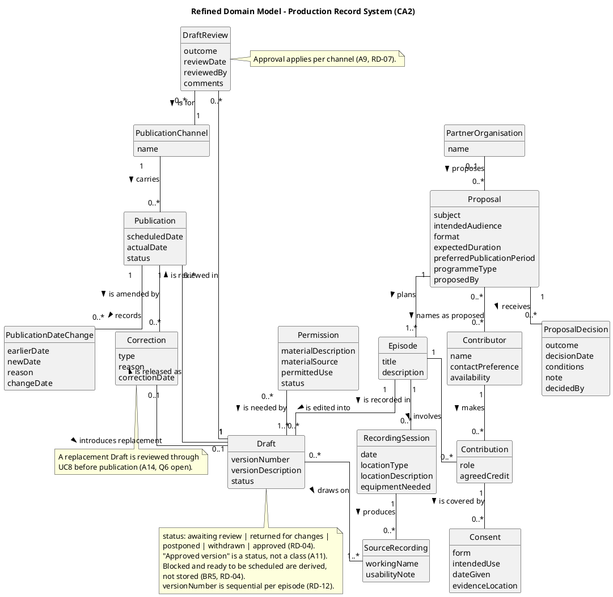
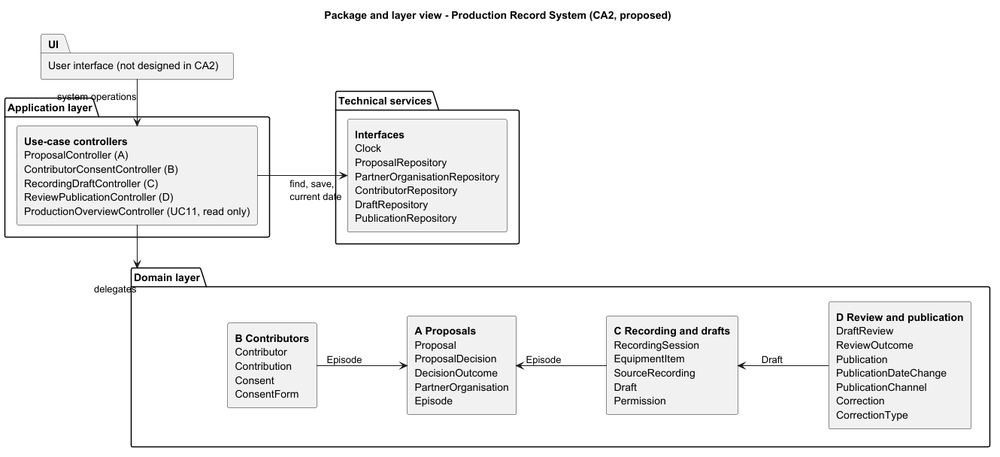

# CA2 Design Dossier – Production Record System

**Scenario:** 29 Local Podcast Production Service (Kerry Community Media Collective)  
**Module:** Software Analysis and Design (SAAD71000), CA2  
**Board item:** #47 Compile and review the final CA2 design dossier  
**Source state:** group repository `main` at commit `17ae664` (27/11/26)  
**Language:** ASD-STE100 Simplified Technical English  
**Status:** Draft for group review. The `ca2-submission` tag does not exist yet.

| Member         | Section                      | Use cases      |
|----------------|------------------------------|----------------|
| Rani Wheeza    | A – Proposal management      | UC1, UC2       |
| Arno Coetzer   | B – Contributors and consent | UC3, UC4       |
| Jack O'Mahoney | C – Recording and drafts     | UC5, UC6, UC7  |
| Tsubasa Hirose | D – Review and publication   | UC8, UC9, UC10 |
| All            | Shared                       | UC11           |

## Contents

1. [About this dossier](#1-about-this-dossier)
2. [Scenario selection and agreed baseline](#2-scenario-selection-and-agreed-baseline)
3. [Product Goal and Product Backlog](#3-product-goal-and-product-backlog)
4. [Selected design scope](#4-selected-design-scope)
5. [Behavioural design of UC2](#5-behavioural-design-of-uc2)
6. [Responsibilities: CRC cards and GRASP decisions](#6-responsibilities-crc-cards-and-grasp-decisions)
7. [Object interactions for UC2](#7-object-interactions-for-uc2)
8. [Design class diagram](#8-design-class-diagram)
9. [Design structure and shared interfaces](#9-design-structure-and-shared-interfaces)
10. [Traceability matrix](#10-traceability-matrix)
11. [Design evaluation](#11-design-evaluation)
12. [Process, review and contribution evidence](#12-process-review-and-contribution-evidence)
13. [References](#13-references)

## 1. About this dossier

This dossier explains and justifies the CA2 design for Scenario 29. It does not repeat each repository file. The group repository is the authoritative source for the editable artefacts and the version history. Each section of this dossier gives links to the files that contain the full detail.

The word limit of the brief applies to the text only. Diagrams, tables, references and appendices are not part of the count. The text of this dossier has approximately 4,300 words, including table text.

The dossier uses ASD-STE100 Simplified Technical English. The sentences are short and use one meaning for each word. Class names, operation names and identifiers (FR, BR, UC, GS, RD, DEC) are technical names. They are the same as in the repository.

## 2. Scenario selection and agreed baseline

### 2.1 Scenario comparison and selection

Each member presented the scenario from their CA1. The group compared the four scenarios against the four criteria of the brief. The criteria are scope, behavioural richness, object-oriented potential and suitability for detailed design. The [scenario suitability matrix](https://github.com/Rani-Wheeza/Local-Podcast-Production-Service/blob/main/CA%202/Group_Documents/Scenario_Suitability_Matrix/Scenario%20suitability%20matrix.md) records the ratings and the reasons.

| Scenario                                          | Member  | Main strength                                        | Main problem for CA2                            |
|---------------------------------------------------|---------|------------------------------------------------------|-------------------------------------------------|
| 29 Local Podcast Production Service               | Rani    | Clear production lifecycle and a manageable boundary | Many related stages and permission records      |
| 31 KETCo Unified Digital Platform                 | Arno    | Detailed processes for samples, tests and reports    | Large technical scope with laboratory equipment |
| 11 Atlantic Edge Experiences                      | Jack    | Clear bookings, participants and instructors         | The CA1 analysis is in many separate files      |
| 36 Banking Operations Change and Incident Service | Tsubasa | Rich approval and incident workflows                 | Many connected processes and complex rules      |

The ratings were close. All four scenarios had high ratings for behaviour, object-oriented potential and testability. The group selected Scenario 29 for one main reason. Its CA1 analysis was already one dossier with traceability, business rules, Gherkin and a domain model. Thus, it was the baseline with the least work to do. The lecturer approved the selection on 02/11/26 (DEC-01).

### 2.2 Lecturer instructions

The lecturer gave instructions after the approval. The [reconciliation record](https://github.com/Rani-Wheeza/Local-Podcast-Production-Service/blob/main/CA%202/Group_Documents/Reconciliation_Record/CA1_Reconciliation_Record.md) (section 3) records each instruction and the group response.

| ID | Instruction                                   | Group response                                                                                                                    |
|----|-----------------------------------------------|-----------------------------------------------------------------------------------------------------------------------------------|
| L2 | CA3 will not run                              | No CA3 slice specifications. The catalogue order uses value, dependency and risk (DEC-03).                                        |
| L3 | Four artefacts removed                        | The architecture contract, slice specifications, technology record and contribution evidence document were removed from the plan. |
| L4 | CA2 weighting changed from 15% to 30%         | No change to the scope.                                                                                                           |
| L6 | Detailed design for one or two use cases only | UC2 has the full design. UC8 is second if time allows (DEC-09).                                                                   |

### 2.3 Reconciliation of the CA1 material

The four CA1 analyses are for different organisations. Thus, the group did not merge their requirements or classes (RD-14). The group did two things. First, all members examined the Scenario 29 analysis critically. Second, the group used good methods from the other three CA1s.

The group kept all CA1 identifiers. This keeps the CA1 traceability correct. The table shows the changes that have an effect on the design. The reconciliation record gives all 19 decisions (RD-01 to RD-19).

| ID            | Change                                                                                    | Effect on the design                                           |
|---------------|-------------------------------------------------------------------------------------------|----------------------------------------------------------------|
| RD-04         | "Blocked" is derived. It is not a stored draft state.                                     | `Draft.status` keeps only review states.                       |
| RD-05, DEC-05 | "Contributor confirmation" in BR5 is consent.                                             | One term, one class (`Consent`).                               |
| RD-06, DEC-05 | An editorial decision is outstanding only if a draft was returned and not reviewed again. | An unreviewed draft is "awaiting review", not "blocked".       |
| RD-07         | `DraftReview` is for one `PublicationChannel`.                                            | Approval applies to each channel.                              |
| RD-11         | Two-column actor/system use-case format (from Jack's CA1).                                | The format maps directly to SSD messages.                      |
| RD-12         | `Draft.versionNumber` (from Arno's CA1).                                                  | Each draft has a stable identifier.                            |
| DEC-07        | FR1 also records the proposer.                                                            | `Proposal.proposedBy` and the partner link have a requirement. |
| DEC-08        | `ProposalDecision.note` added.                                                            | A reason for rejection is not kept as a condition.             |
| DEC-11        | One consent covers all drafts and channels until Q3 has an answer.                        | Assumption A15 in the baseline.                                |

The other CA1s gave methods, not content. Jack's CA1 gave the two-column use-case format. In this format, each actor step maps to an SSD message and each system step maps to a return.

Arno's CA1 gave sequential version numbers. These give each draft a stable identifier without a decision about versions (Q4). Tsubasa's CA1 gave an evidence and uncertainty register. Scenario 29 already had one, so the group added no new artefact.

Tsubasa did a peer review of the reconciliation decisions on issue #6. The group changed RD-06 and RD-08 after this review. All four members agreed the decisions on 13/11/26.

### 2.4 Agreed baseline

The [revised analysis baseline](https://github.com/Rani-Wheeza/Local-Podcast-Production-Service/blob/main/CA%202/Group_Documents/Analysis_Baseline/analysis-baseline.md) is the CA1 analysis with the changes above. It contains the use-case catalogue, the detailed UC2 specification, the Gherkin index, the refined domain model and the traceability table. The CA1 material that did not change stays in the CA1 folder. This dossier does not repeat it.

*Figure 1: Use-case diagram. Source: `CA 1/Diagrams/use-case-model.puml.txt`.*

*Figure 2: Refined domain model with the CA2 changes. Source: `CA 2/Diagrams/Domain_Model/domain_Model.puml`.*

## 3. Product Goal and Product Backlog

### 3.1 Product Goal

> Give Kerry Community Media Collective one reliable production record, so that staff can see where every programme stands from proposal to publication and any later correction, and what is blocking it, while editorial notes and sensitive contributor information stay restricted by role.

The [Product Goal](https://github.com/Rani-Wheeza/Local-Podcast-Production-Service/blob/main/CA%202/Group_Documents/Product_Goal/product-goal.md) gives the users, the value and the result. It does not name diagrams or technical tasks. The group added "any later correction" after the iteration 1 review.

### 3.2 Backlog and board

The group uses GitHub Projects as the board (DEC-02). Each backlog item is a GitHub issue. Each commit refers to its issue number. Thus, the board, the commits and the pull requests stay in one place.

The backlog contains analysis and design tasks, review tasks, defects and design enablers. Each item has an owner and a reviewer. Examples are:

- #6: reconciliation record.
- #21 to #24: SSDs and contracts for each section.
- #36 and #37: UC2 interaction diagrams.
- #43: CRC integration and controller pattern.
- #44 and #45: design class diagram and consistency check.

The group changed the backlog after the lecturer instruction L6. The interaction-diagram cards for each section became shared UC2 cards. The group closed the cards that were not necessary as "Not planned" (#33 to #35, #38, #39).

### 3.3 Definition of Done

The [Definition of Done](https://github.com/Rani-Wheeza/Local-Podcast-Production-Service/blob/main/CA%202/Group_Documents/Definition_of_Done/definition-of-done.md) applies to all items. A draft alone is not "Done". An item is "Done" only when these conditions are true:

- The editable source (`.md`, `.puml`, `.feature`) is in the repository and the exported image is easy to read.
- The identifiers and terms agree with the glossary and the baseline.
- A member who is not the owner reviewed the item. The owner resolved or recorded the comments.
- Each decision is in the decision log.
- Each use of AI is in the AI interaction log.

Each diagram must also have a PlantUML source that renders without errors. Each class, message and operation must agree with the design class diagram and the contracts.

## 4. Selected design scope

The lecturer limited detailed design to one or two use cases (L6). The group selected UC2 "Record a proposal decision" for the full design. UC8 "Review a draft" was the second use case, but the group did not have time to design it. The [implementation catalogue](https://github.com/Rani-Wheeza/Local-Podcast-Production-Service/blob/main/CA%202/Group_Documents/Implementation_Catalogue/implementation-catalogue.md) records the order, the depth and the reasons.

### 4.1 Why UC2

| Aspect                 | UC2 Record a proposal decision                                                                                                 |
|------------------------|--------------------------------------------------------------------------------------------------------------------------------|
| Value                  | Prevents the error where a friendly conversation is taken as approval (P2, BR1). This is the clearest problem in the scenario. |
| Requirements and rules | FR3, FR12, BR1, BR2, A13                                                                                                       |
| Behaviour              | Four outcomes (BR2), a repeated decision after "returned" or "held", and a controlled failure                                  |
| State change           | A new `ProposalDecision`. The derived state of the proposal changes.                                                           |
| Dependency             | UC1 only (a proposal exists). The design does not wait for other sections.                                                     |
| Selection reason       | Two members proposed it. All members agreed it (DEC-09).                                                                       |

UC8 connects consent (Section B), permissions (Section C) and reviews (Section D). Thus, it shows the integration of the sections better. But it depends on three other use cases and on the open questions Q5 and Q6. For this reason, the group put it second.

### 4.2 Design depth of all use cases

All other use cases have analysis and behaviour only. Each section owner wrote the requirements review, the Gherkin scenarios, the SSDs and the operation contracts for their use cases. These artefacts are analysis evidence. They have no interaction diagrams.

| Depth                  | Use cases                   | Artefacts                                                                                         |
|------------------------|-----------------------------|---------------------------------------------------------------------------------------------------|
| Full design            | UC2                         | Detailed use case, Gherkin, SSD, contract, CRC, GRASP, interaction diagrams, design class diagram |
| Analysis and behaviour | UC1, UC3–UC11               | Requirements review, Gherkin, SSD, contracts, CRC cards and GRASP notes for each section          |
| Not designed           | UC8 as a second full design | No time (implementation catalogue, section 6)                                                     |

## 5. Behavioural design of UC2

### 5.1 Detailed use case

[Section A](../Individual_Contributions/Section_A_Proposal_Rani/CA2_Section_A.md) contains the detailed use case in the two-column format. The primary actor is the proposal editor. The editor identifies the proposal. The system shows its details, its earlier decisions and its earlier conditions.

The editor gives the outcome, any conditions and an optional note. The system records the decision with the date and the name of the editor. Then it shows the new state.

There are three alternative flows. The editor can reject the proposal (3a), return it for revision (3b) or hold it (3c). There are also three exception flows:

- E1: The proposal is incomplete. The system does not stop the decision, because the scenario does not give a minimum (Q1).
- E2: The last decision was "returned" or "held". The editor records a new decision. The system keeps the earlier one.
- E3: The editor stops before saving. Nothing changes.

The use case does not let the editor reopen an accepted or rejected proposal. This depends on the meaning of "significant change", which is open (Q2).

### 5.2 Gherkin scenarios

The scenarios are in [`Section_A_Proposal.feature`](https://github.com/Rani-Wheeza/Local-Podcast-Production-Service/blob/main/CA%202/Requirements_and_Gherkin/Feature_Files/Section_A_Proposal.feature). The tags give the requirement, the use case, the rule and the case type. Each section uses its own number block (DEC-06).

| ID   | Scenario                                                                                  | Type        | Rules          |
|------|-------------------------------------------------------------------------------------------|-------------|----------------|
| GS1  | Proposal accepted with a condition                                                        | Success     | FR3            |
| GS2  | A proposal with no decision is shown differently from a held proposal and an approved one | Boundary    | FR3, FR12, BR1 |
| GS13 | Proposal editor rejects a proposal                                                        | Alternative | BR2            |
| GS14 | A proposal returned for revision is later accepted, and the system keeps both decisions   | Alternative | BR2            |
| GS15 | Proposal editor holds a proposal for future consideration                                 | Alternative | BR2            |
| GS16 | No decision is recorded when the editor stops before the system saves                     | Failure     | BR1            |

### 5.3 System sequence diagram

The SSD shows the editor and the system as a black box. It has two system operations. `selectProposal` is a query. It changes nothing, so it has no contract. `recordDecision` changes the state, so it has contract CO4.

*Figure 3: SSD for UC2. Source: `CA 2/Diagrams/System_Sequence_Diagrams/SSD_UC2_RecordDecision.puml`.*

### 5.4 Operation contract CO4

| Item                | Content                                                                                                                                                                                                                                                                                                |
|---------------------|--------------------------------------------------------------------------------------------------------------------------------------------------------------------------------------------------------------------------------------------------------------------------------------------------------|
| Operation           | `recordDecision(proposal, outcome, conditions, note)`                                                                                                                                                                                                                                                  |
| Cross-references    | UC2, FR3, BR1, BR2, A13 · GS1, GS2, GS13–GS16                                                                                                                                                                                                                                                          |
| Preconditions       | `proposal` exists. It has no recorded decision, or its latest decision is "returned for revision" or "held". The user acts as proposal editor (Q5 is open).                                                                                                                                            |
| Postconditions      | A `ProposalDecision` instance `d` was created. `d.outcome` was set to one of the four BR2 outcomes. `d.decisionDate` was set to the current date and `d.decidedBy` to the editor. `d.conditions` and `d.note` were set if given. `d` was associated with `proposal`. Earlier decisions did not change. |
| Controlled failures | Latest decision is "accepted" or "rejected": no decision is created (Q2). Outcome is not one of the four in BR2: no decision is created.                                                                                                                                                               |

The contract does not set a status on the proposal. The displayed state comes from the latest decision. This rule keeps one source of truth for BR1. Section 6.3 gives the reason.

### 5.5 Behaviour of the other use cases

Each section wrote SSDs and contracts for its use cases. The table gives a summary. The section files contain the full detail.

| Section                                                                                                                                                       | SSDs                       | Contracts                                                                                                                   | Feature file        |
|---------------------------------------------------------------------------------------------------------------------------------------------------------------|----------------------------|-----------------------------------------------------------------------------------------------------------------------------|---------------------|
| [A](https://github.com/Rani-Wheeza/Local-Podcast-Production-Service/blob/main/CA%202/Individual_Contributions/Section_A_Proposal_Rani/CA2_Section_A.md)       | UC1, UC2                   | CO1 recordProposal, CO2 addPlannedEpisode, CO3 updateProposalDetails, CO4 recordDecision                                    | GS1, GS2, GS10–GS16 |
| [B](https://github.com/Rani-Wheeza/Local-Podcast-Production-Service/blob/main/CA%202/Individual_Contributions/Section_B_Contributors_Arno/CA2_Section_B.md)   | UC3, UC4                   | CB1 recordContributor, CB2 recordContribution, CB3 updateContributorDetails, CB4 recordConsent                              | GS20–GS25           |
| [C](https://github.com/Rani-Wheeza/Local-Podcast-Production-Service/blob/main/CA%202/Individual_Contributions/Section_C_Recording_Jack/CA2_Section_C.md)      | UC5 (two), UC6, UC7 (two)  | OC05 recordRecordingSession, OC06 recordSourceRecording, OC07 recordDraft, OC08 recordPermission, OC09 viewDraftPermissions | GS40–GS47           |
| [D](https://github.com/Rani-Wheeza/Local-Podcast-Production-Service/blob/main/CA%202/Individual_Contributions/Section_D_Review_Tsubasa/CA2_Section%20D.md)    | UC8 (two), UC9 (two), UC10 | OC01 recordReview, OC02 recordPublicationDate, OC03 changePublicationDate, OC04 recordCorrection                            | GS3–GS5, GS30–GS36  |
| [Shared](https://github.com/Rani-Wheeza/Local-Podcast-Production-Service/blob/main/CA%202/Behavioural_Design/Operation_Contracts/UC11_Production_Overview.md) | UC11                       | CO11.1 viewProductionOverview, CO11.2 viewDraftBlockers                                                                     | GS2, GS4, GS24      |

The sections share some rules. These rules have an effect on the design of more than one section:

- BR5 (blocked draft): Section C keeps the permissions and Section B keeps the consents. Section D asks `Draft` and `Episode` for the outstanding items. "Blocked" is not stored (RD-04).
- BR3 (review before publication): only `recordReview` in UC8 changes the review status of a draft. The group removed `recordDraftStatus` from UC6, because it let a volunteer go around the editor review (CRC change 3.9).
- GS5 (date change): `changePublicationDate` creates a `PublicationDateChange`. It keeps the earlier date and the reason. A later change does not replace them.
- UC11 (overview): the overview only reads data. It asks the class that keeps each item, for example `Proposal.currentState()` and `Episode.outstandingConsents()`.

The SSD files are in [`Diagrams/System_Sequence_Diagrams/`](https://github.com/Rani-Wheeza/Local-Podcast-Production-Service/tree/main/CA%202/Diagrams/System_Sequence_Diagrams).

## 6. Responsibilities: CRC cards and GRASP decisions

### 6.1 CRC cards for UC2

The CRC cards give the work in CO4 to classes. The domain classes come from the refined domain model. The design adds a controller, a repository and a clock interface. The full cards are in Section A. The [integrated CRC list](https://github.com/Rani-Wheeza/Local-Podcast-Production-Service/blob/main/CA%202/Object_Oriented_Design/CRC_Cards/integrated-crc-cards.md) gives the cards of all sections.

| Class                | Knowing                                 | Doing                                                                                                                      | Collaborators                       |
|----------------------|-----------------------------------------|----------------------------------------------------------------------------------------------------------------------------|-------------------------------------|
| `Proposal`           | Its subject, details and proposer       | Creates and keeps its decisions. Tells if a new decision is allowed. Gives its current state from the latest decision.     | ProposalDecision                    |
| `ProposalDecision`   | Outcome, date, editor, conditions, note | Tells if its outcome leaves the proposal open ("returned" or "held")                                                       | DecisionOutcome                     |
| `DecisionOutcome`    | The four BR2 outcomes                   | –                                                                                                                          | –                                   |
| `ProposalController` | –                                       | Receives `selectProposal` and `recordDecision`. Finds the proposal, gets the date, sends the work to `Proposal` and saves. | ProposalRepository, Clock, Proposal |
| `ProposalRepository` | –                                       | Finds and saves proposals                                                                                                  | Proposal                            |
| `Clock`              | The current date                        | –                                                                                                                          | –                                   |

### 6.2 Responsibility rationale

The controller makes no business decisions. It only receives, finds, delegates and saves. `Proposal` keeps its decision history. Thus, `Proposal` has the information to decide if a new decision is allowed.

`ProposalDecision` knows its own outcome. Thus, it tells if the proposal stays open. This keeps each rule in the class that has the data.

### 6.3 GRASP decisions

The brief asks for a minimum of four important decisions. The table gives six. Each decision gives the candidates, the principle, the rejected alternative and the consequence.

| ID | Problem                                                         | Candidates                                                                 | Decision                                                                                                    | Principle                         | Rejected alternative                                                                        | Consequence                                                                       |
|----|-----------------------------------------------------------------|----------------------------------------------------------------------------|-------------------------------------------------------------------------------------------------------------|-----------------------------------|---------------------------------------------------------------------------------------------|-----------------------------------------------------------------------------------|
| G1 | Which object receives the system operations?                    | One facade controller; one controller for each section; the user interface | One use-case controller for each section, plus a read-only `ProductionOverviewController` for UC11 (DEC-10) | Controller, High Cohesion         | A facade controller with approximately 24 operations (a God controller)                     | Five small controllers. No controller calls a controller of a different section.  |
| G2 | Which object creates a `ProposalDecision`?                      | `ProposalController`; `Proposal`                                           | `Proposal`                                                                                                  | Creator                           | The controller creates it. Then the controller must know the decision rule.                 | `Proposal.recordDecision(...)` creates the decision. The controller stays simple. |
| G3 | Where is the state of a proposal?                               | A stored `status` attribute; the State pattern; a derived state            | Derived from the latest `ProposalDecision`                                                                  | Information Expert                | A stored status. It repeats the latest decision, and the two can disagree.                  | `Proposal.currentState()`. One source of truth for BR1 and A13.                   |
| G4 | Which object tells if a new decision is allowed?                | `ProposalController`; `Proposal`                                           | `Proposal`, with help from the latest `ProposalDecision`                                                    | Information Expert, High Cohesion | The controller checks the rule. This moves the knowledge of `Proposal` into the controller. | `canRecordDecision()` and `leavesProposalOpen()`                                  |
| G5 | Which object finds and saves objects?                           | `Proposal`; the controller; a repository                                   | `ProposalRepository`                                                                                        | Pure Fabrication, Low Coupling    | `Proposal` saves itself. This mixes storage with domain logic.                              | All sections use repositories (DEC-10).                                           |
| G6 | How does the design get the date and keep invalid outcomes out? | System time in the domain; a `Clock` interface; a text outcome             | `Clock` interface and `DecisionOutcome` enumeration                                                         | Protected Variations              | System time inside `Proposal`. Tests cannot use a fixed date.                               | A test can use a fixed clock. Only the four BR2 outcomes are possible.            |

The sections also used Information Expert across their boundaries. For example, Section D asks `Episode.hasOutstandingConsent()` for BR5. It does not read `Consent` directly. This keeps the coupling between Sections B and D low (integrated CRC list, change 3.2).

## 7. Object interactions for UC2

### 7.1 Main flow

The main flow is GS1: the editor accepts a proposal with a condition. The controller finds the proposal and gets the date from `Clock`. The controller takes the editor from the session. The actor does not enter it. Then the controller sends `recordDecision` to `Proposal`.

`Proposal` calls `canRecordDecision()`. If the proposal has an earlier decision, it asks that decision `leavesProposalOpen()`.

In GS1 there is no earlier decision, so the result is "allowed". `Proposal` then creates the new `ProposalDecision`. It returns "recorded". The controller saves the proposal and asks for `currentState()`. The system shows the proposal as accepted, with its condition, the editor and the date.

*Figure 4: Interaction diagram, UC2 main flow (GS1). Source: `CA 2/Diagrams/Object_Interaction_Diagrams/OID_UC2_Accepted.puml`.*

### 7.2 Alternatives and the controlled failure

The rejected, returned and held flows (GS13, GS14, GS15) use the same messages. Only the outcome and the note are different. A returned or held decision leaves the proposal open for a later decision.

The controlled failure is different. The latest decision is "accepted" or "rejected". Thus, `leavesProposalOpen()` gives false. `Proposal` returns "refused" and creates no decision.

The controller does not save. The system tells the editor that the proposal already has a final decision. GS16 sends no system event, so it has no interaction diagram.

*Figure 5: Interaction diagram, rejected (GS13). Source: `OID_UC2_Rejected.puml`.*

*Figure 6: Interaction diagram, returned for revision (GS14). Source: `OID_UC2_Returned.puml`.*

*Figure 7: Interaction diagram, held for future consideration (GS15). Source: `OID_UC2_Held.puml`.*

*Figure 8: Interaction diagram, controlled failure (CO4). Source: `OID_UC2_AlreadyDecided.puml`.*

### 7.3 Messages and operations

Each message in the interaction diagrams agrees with an operation in the design class diagram.

| Message                                                    | Receiver           | DCD operation                                               | Contract            |
|------------------------------------------------------------|--------------------|-------------------------------------------------------------|---------------------|
| `selectProposal(proposal)`                                 | ProposalController | `+selectProposal(proposal)`                                 | None (query)        |
| `recordDecision(proposal, outcome, conditions, note)`      | ProposalController | `+recordDecision(proposal, outcome, conditions, note)`      | CO4                 |
| `find(proposal)`, `save(p)`                                | ProposalRepository | `+find(proposal): Proposal`, `+save(proposal)`              | –                   |
| `currentDate()`                                            | Clock              | `+currentDate(): Date`                                      | CO4 `decisionDate`  |
| `getDetails()`                                             | Proposal           | `+getDetails()`                                             | –                   |
| `recordDecision(outcome, editor, today, conditions, note)` | Proposal           | `+recordDecision(outcome, editor, today, conditions, note)` | CO4 postconditions  |
| `canRecordDecision()`                                      | Proposal           | `+canRecordDecision(): boolean`                             | CO4 preconditions   |
| `leavesProposalOpen()`                                     | ProposalDecision   | `+leavesProposalOpen(): boolean`                            | CO4 failure         |
| `create(...)`                                              | ProposalDecision   | Association *Proposal receives ProposalDecision*            | CO4 "d was created" |
| `currentState()`                                           | Proposal           | `+currentState()`                                           | BR1, A13            |

## 8. Design class diagram

The design class diagram shows the classes, the operations and the dependencies for UC2. `Proposal` has no status attribute, because its state is derived. The diagram uses dependencies from the controller to `Proposal`, `ProposalRepository` and `Clock`. This shows that the controller uses these objects but does not own them. The association *Proposal receives ProposalDecision* (1 to 0..\*) keeps the decision history.

`Proposal.recordDecision` gives the result "recorded" or "refused". The group did not add a boolean or a separate `DecisionResult` type (review item R21). This result is different from `DecisionOutcome`. `DecisionOutcome` is the choice of the editor. The result tells if the system recorded the attempt.

*Figure 9: Design class diagram for UC2. Source: `CA 2/Diagrams/Design_Class_Diagram/DCD_UC2_RecordDecision.puml`.*

## 9. Design structure and shared interfaces

### 9.1 Package and layer view

The design has three layers. The application layer contains the five use-case controllers. The domain layer contains one package for each section. The technical services contain the `Clock` interface and the repositories. The user interface is outside the CA2 design.

The dependencies go in one direction only. The controllers use the domain and the technical services. The domain does not use the controllers. Sections B and C use Section A only through `Episode`. Section D uses Section C through `Draft`.

*Figure 10: Package and layer view (proposed). The group must review this view. Source: `Package_View.puml` in this folder. Add it to `CA 2/Diagrams/` before the tag. It uses DEC-10, the design class diagram and the integrated CRC list.*

### 9.2 Interfaces, result types and conventions

| Item                                                                                                                       | Type                          | Purpose                                                                                               | Used by                                                                           |
|----------------------------------------------------------------------------------------------------------------------------|-------------------------------|-------------------------------------------------------------------------------------------------------|-----------------------------------------------------------------------------------|
| `Clock.currentDate(): Date`                                                                                                | Interface                     | Gives the current date. A test can use a fixed clock.                                                 | All controllers (DEC-10)                                                          |
| `ProposalRepository`, `PartnerOrganisationRepository`, `ContributorRepository`, `DraftRepository`, `PublicationRepository` | Interfaces (Pure Fabrication) | Find and save objects by identifier                                                                   | The controller of the owner section, and `ProductionOverviewController` for reads |
| `DecisionOutcome`, `ReviewOutcome`, `ConsentForm`, `CorrectionType`                                                        | Enumerations                  | Keep the values to the list in the rules (for example BR2)                                            | Domain classes                                                                    |
| "recorded" or "refused"                                                                                                    | Result convention             | The domain object gives the result. The controller saves only when the result is "recorded".          | `Proposal.recordDecision`                                                         |
| Controlled failure                                                                                                         | Error convention              | A failed operation changes nothing and gives the reason. Each contract lists its controlled failures. | All contracts                                                                     |
| Derived state                                                                                                              | State convention              | "Blocked", "awaiting a decision" and similar states are calculated, not stored (RD-04, BR1).          | `Proposal`, `Draft`                                                               |

### 9.3 Rules for all controllers

DEC-10 gives four rules for each controller:

1. Receive the system operations, find the objects, send the work to the domain objects and save. Do not make business decisions.
2. Get the current date from the shared `Clock` interface.
3. Use repositories to find and save objects.
4. Do not call the controller of a different section. Send questions between sections to the domain objects.

## 10. Traceability matrix

The table gives one row for the selected use case. It links the backlog to each design artefact. The baseline traceability table (section 10) and the section files give the rows for the other use cases.

| Use case                       | Backlog                                         | Requirements and rules                           | Gherkin             | SSD                      | Contracts            | CRC and GRASP                         | Interactions                                                             | Design classes                                                                             |
|--------------------------------|-------------------------------------------------|--------------------------------------------------|---------------------|--------------------------|----------------------|---------------------------------------|--------------------------------------------------------------------------|--------------------------------------------------------------------------------------------|
| UC2 Record a proposal decision | #9, #15, #21, #28, #32, #36, #37, #43, #44, #45 | FR3, FR12, BR1, BR2, A13, DEC-08, DEC-09, DEC-10 | GS1, GS2, GS13–GS16 | `SSD_UC2_RecordDecision` | CO4 `recordDecision` | Section A cards; G1–G6 in section 6.3 | `OID_UC2_Accepted`, `_Rejected`, `_Returned`, `_Held`, `_AlreadyDecided` | ProposalController, ProposalRepository, Clock, Proposal, ProposalDecision, DecisionOutcome |

The next table shows the coverage of all requirements. Each functional requirement has a use case, Gherkin scenarios, an SSD and contracts.

| Req  | Use case | Section | Gherkin                   | Contracts      | Controller                   |
|------|----------|---------|---------------------------|----------------|------------------------------|
| FR1  | UC1      | A       | GS10, GS11                | CO1, CO3       | ProposalController           |
| FR2  | UC1      | A       | GS12                      | CO2            | ProposalController           |
| FR3  | UC2      | A       | GS1, GS2, GS13–GS16       | CO4            | ProposalController           |
| FR4  | UC3      | B       | GS20, GS21                | CB1, CB2, CB3  | ContributorConsentController |
| FR5  | UC4      | B       | GS22–GS24                 | CB4            | ContributorConsentController |
| FR6  | UC5      | C       | GS40, GS41, GS47          | OC05           | RecordingDraftController     |
| FR7  | UC6      | C       | GS42–GS44                 | OC06, OC07     | RecordingDraftController     |
| FR8  | UC7, UC8 | C, D    | GS4, GS45, GS46           | OC08, OC09     | RecordingDraftController     |
| FR9  | UC8      | D       | GS3, GS4, GS24, GS30–GS33 | OC01           | ReviewPublicationController  |
| FR10 | UC9      | D       | GS5, GS34                 | OC02, OC03     | ReviewPublicationController  |
| FR11 | UC10     | D       | GS35, GS36                | OC04           | ReviewPublicationController  |
| FR12 | UC11     | Shared  | GS2, GS4, GS24            | CO11.1, CO11.2 | ProductionOverviewController |
| NFR1 | –        | B       | GS25                      | –              | Not assigned (Q7, Q9 open)   |

## 11. Design evaluation

### 11.1 Cohesion and coupling

Each class in the UC2 design has one clear purpose. The controller does not keep business rules. `Proposal` keeps the decision history and the rules about it. `ProposalDecision` keeps one decision. Thus, cohesion is high.

The controller depends on `Proposal`, one repository and `Clock`. It does not depend on `ProposalDecision`. Thus, a change inside a decision does not have an effect on the controller. Between sections, the design uses `Episode` and `Draft` as the only shared points. This keeps the coupling between sections low.

### 11.2 Controllers

The group compared three controller options (G1). A facade controller is simple to find, but it receives approximately 24 operations. One controller for each section keeps each controller small. The read-only `ProductionOverviewController` reads data from all sections, but it does not change data. This is a good result for UC11, because CO11.1 and CO11.2 have no postconditions.

There is a risk. `ProductionOverviewController` uses many domain classes. If the overview gets more categories, this controller can become too large. The design can then add a query object for each category.

### 11.3 Object validity

The design does not let an object get into an incorrect state. `Proposal` creates its decisions, so a decision cannot exist without a proposal. The enumeration prevents an outcome that is not in BR2. The derived state prevents a status that disagrees with the latest decision. Earlier decisions do not change, so the history stays complete (GS14).

### 11.4 Consistency between the models

The compiler of this dossier compared the UC2 artefacts. Each message in the interaction diagrams has an operation in the design class diagram (section 7.3). The operation parameters agree with the SSD and with CO4. The preconditions of CO4 agree with `canRecordDecision()`. The postconditions agree with the creation of `ProposalDecision` and with the unchanged earlier decisions.

The second controlled failure of CO4 is an outcome that is not in BR2. No interaction diagram shows it. The `DecisionOutcome` enumeration prevents this outcome before the call. Thus, a diagram for it is not necessary. This comparison does not replace the group consistency check (#45).

### 11.5 Testability

The design is easy to test. The `Clock` interface lets a test use a fixed date. Thus, a test can examine the decision date in GS1 and GS14.

The repositories are interfaces. Thus, a test can use a repository in memory. Each Gherkin scenario for UC2 maps to one interaction diagram, except GS2 and GS16. GS2 tests the overview (UC11). GS16 sends no system event.

### 11.6 Assumptions and open questions

The design uses these assumptions. Each one is easy to change if the client gives a different answer.

- Q1: A proposal can get a decision when details are not known. The system does not stop the decision.
- Q2: An accepted or rejected proposal cannot get a new decision. The design shows this as a controlled failure.
- Q5: The design records the editor but does not check the authority of the editor.
- Q3 (DEC-11): One consent covers all drafts and channels of an episode.

### 11.7 Rejected alternatives

The group rejected these alternatives. Section 6.3 gives the reasons.

- A stored `status` attribute on `Proposal`.
- The State pattern for proposal states. The decisions are a history, not a change of behaviour.
- One controller for the whole system.
- A separate `DecisionResult` type or a boolean result (R21).
- A `Series` class (RD-15). A series is a proposal with many episodes.

### 11.8 Risks and limitations

The design has these limitations at commit `17ae664`:

- The consistency check of the design class diagram, the interaction diagrams and the contracts (#45) is not in the repository.
- The design class diagram does not show the return type "recorded" or "refused". It shows this only in a note.
- The editor comes from the session. The design has no class for the session or the user, because the user interface is outside the scope.
- The domain model does not include `EquipmentItem` yet (change 3.12 in the integrated CRC list).
- Two changes in the integrated CRC list are not complete: one `Draft` card (3.1) and the status for each channel (3.10).
- UC8 has no full design. Thus, the dossier shows the integration of the sections only through the CRC cards, the contracts and DEC-10.

## 12. Process, review and contribution evidence

### 12.1 Decisions

The [decision log](https://github.com/Rani-Wheeza/Local-Podcast-Production-Service/blob/main/CA%202/Decisions_and_Reviews/Decision_Log/Decision_Log.md) has 11 decisions (DEC-01 to DEC-11). Each decision gives the context, the decision, the reasons, the rejected alternatives and the consequences. The reconciliation record keeps the RD decisions, so the log does not repeat them (DEC-04).

### 12.2 Peer review

The group did reviews on GitHub issues and pull requests. Each card has a reviewer who is not the owner. Examples are:

- Issue #6: Tsubasa reviewed the reconciliation decisions. The group changed RD-06 and RD-08.
- Section B review record: Arno asked for a review of Section B, the UC2 interaction diagrams and the CRC integration. It has 21 review items (R1 to R21). Each item has a named reviewer.
- Issue #43: Rani, Jack and Tsubasa agreed the controller pattern (DEC-10).

### 12.3 Iteration records and retrospective

The group recorded the iteration reviews in [`Decisions_and_Reviews/Review_Records/`](https://github.com/Rani-Wheeza/Local-Podcast-Production-Service/tree/main/CA%202/Decisions_and_Reviews/Review_Records).

| Iteration | Board item | Record                                                                                                   |
|-----------|------------|----------------------------------------------------------------------------------------------------------|
| 1         | #10        | Group review and retrospective. Goal: agree the scenario, Product Goal, Definition of Done and baseline. |
| 2         | #27        | Not in the repository                                                                                    |
| 3         | #46        | Individual record by Jack                                                                                |
| 4         | #50        | Not in the repository                                                                                    |

The iteration 1 retrospective gives one item to keep, one problem and one improvement:

- Keep: one issue for each card, with a named reviewer. The reviews found errors before detailed design.
- Problem: decision statuses stayed "Proposed" after the group agreed them. Copies of files did not stay the same.
- Improvement: update the decision log in the same meeting as the decision. Keep one copy of each document.

The brief also asks for one short final retrospective. The group must write it before the tag.

### 12.4 Contributions

| Member  | Main contributions                                                                                                                                                      |
|---------|-------------------------------------------------------------------------------------------------------------------------------------------------------------------------|
| Rani    | Scenario 29 CA1 baseline, scenario suitability matrix (#2), Product Goal (#3), Definition of Done (#4), board, labels and templates (#5), reconciliation record, revised baseline, refined domain model (#8), implementation catalogue, Section A (UC1, UC2), UC11 SSD and contracts (#25), UC2 main-flow interaction diagram (#36), decision log, README, references |
| Arno    | Section B (UC3, UC4, CB1–CB4), UC2 alternative interaction diagrams (#37), integrated CRC list and controller pattern (#43), Section B review issue, this dossier (#47) |
| Jack    | Section C (UC5–UC7, OC05–OC09), the use-case format (RD-11), UC2 design class diagram (#44), iteration 3 record                                                         |
| Tsubasa | Section D (UC8–UC10, OC01–OC04), review of the reconciliation record (#6), consistency check (#45, open)                                                                |

Each member also submits an individual contribution statement. The commit history and the board show the work of each member.

### 12.5 Design walkthrough

Each member must explain a part of the design in the walkthrough. The brief gives the topics. This dossier gives a start for each topic:

- The Product Goal and the scope: sections 3.1 and 4.
- One use case and its system events: UC2, section 5.
- An important contract: CO4, section 5.4.
- A responsibility decision: G1 to G6, section 6.3.
- Part of an interaction and how messages map to operations: sections 7 and 7.3.
- A rejected alternative, risk or limitation: sections 11.7 and 11.8.

Each member also explains their own section and their use of AI.

### 12.6 AI declarations

The [AI interaction log](https://github.com/Rani-Wheeza/Local-Podcast-Production-Service/blob/main/CA%202/Decisions_and_Reviews/AI_Interaction_Log/AI_Interaction_Log.md) contains declarations from Rani and Tsubasa. Tsubasa used AI for translation, for review against the course references and for help with GitHub. Rani used AI to understand the brief and to organise the board. Rani also used AI to draft and review documents, for example Section A. Both members state that they decided which suggestions to keep. Both state that AI did not make group decisions.

The declarations from Arno and Jack are not in the log yet. A member who did not use AI must write a declaration of no AI use.

The brief asks for a decision record for each important design change that AI helped with. The group must examine the log and add these records before the tag.

## 13. References

- SAAD71000 (2026) *CA2 Portfolio Brief, Part 2: Collaborative Object-Oriented Design*.
- SAAD71000 (2026) *CA1 Scenario 29: Local Podcast Production Service (Kerry Community Media Collective)*.
- Wheeza, R. (2026) *CA1 Requirements and Domain Analysis: Scenario 29, Local Podcast Production Service*.
- Coetzer, J.A. (2026) *KETCo Unified Digital Platform: Requirements and Business Architecture Specification* (Scenario 31).
- O'Mahoney, J. (2026) *CA1 analysis: Atlantic Edge Experiences* (Scenario 11).
- Hirose, T. (2026) *CA1 Requirements and Domain Analysis Dossier* (Scenario 36).
- Larman, C. (2004) *Applying UML and Patterns*. 3rd edn. Upper Saddle River, NJ: Prentice Hall. Chapters 10, 11 and 15–18.
- McLaughlin, B.D., Pollice, G. and West, D. (2006) *Head First Object-Oriented Analysis and Design*. Sebastopol, CA: O'Reilly.
- Sommerville, I. (2016) *Software Engineering*. 10th edn. Harlow: Pearson.
- Schwaber, K. and Sutherland, J. (2020) *The Scrum Guide*. [https://scrumguides.org](https://scrumguides.org)
- ASD (2021) *ASD-STE100 Simplified Technical English*. [https://www.asd-ste100.org](https://www.asd-ste100.org)
- Cucumber (n.d.) *Gherkin reference*. [https://cucumber.io/docs/gherkin/reference/](https://cucumber.io/docs/gherkin/reference/)
- PlantUML (n.d.) *Sequence diagram* and *Class diagram*. [https://plantuml.com](https://plantuml.com)
- Group repository: [Rani-Wheeza/Local-Podcast-Production-Service](https://github.com/Rani-Wheeza/Local-Podcast-Production-Service) and the [full reference list](https://github.com/Rani-Wheeza/Local-Podcast-Production-Service/blob/main/CA%202/References/references.md).

## Open items before the submission

| # | Item                                                                                          | Owner          | Board item |
|---|-----------------------------------------------------------------------------------------------|----------------|------------|
| 1 | Add the consistency check of the DCD, interaction diagrams and contracts                      | Tsubasa        | #45        |
| 2 | Add the iteration 2 review record and retrospective                                           | Tsubasa        | #27        |
| 3 | Add the iteration 4 review record and the final retrospective                                 | Rani           | #50        |
| 5 | Review the package and layer view (Figure 10) and add `Package_View.puml` to `CA 2/Diagrams/` | All            | #47        |
| 6 | Close the open changes in the integrated CRC list (3.1, 3.10, 3.12)                           | Section owners | #43        |
| 8 | Create the `ca2-submission` tag                                                               | Rani           | –          |
