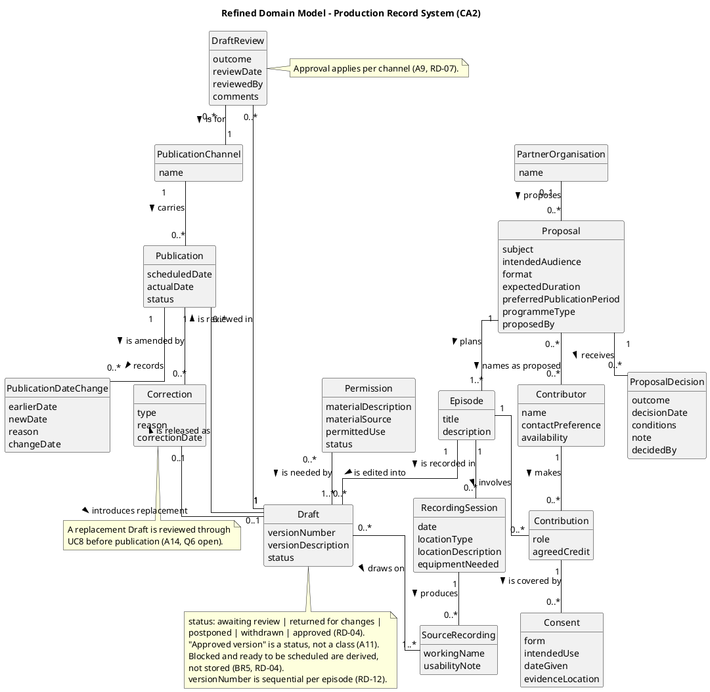

# Revised Analysis Baseline (CA2)

**Scenario:** 29 Local Podcast Production Service (Kerry Community Media Collective)
**Board item:** Create revised analysis baseline
**Status:** Draft for review. **Owner:** Rani | **Reviewer:** Jack,Arno,Tsubasa

## 1. About this baseline

This is the agreed analysis that all CA2 design work builds on. It is the Scenario 29 CA1 analysis with the decisions in the reconciliation record (RD-01 to RD-19) and the decision log (DEC-01 to DEC-05) applied. Identifiers are unchanged from CA1, so existing traceability still holds. Section numbers follow the CA1 dossier; Section 1 (scenario interpretation) stays in the CA1 dossier.

### 1.1 Changes from the CA1 analysis

| Change | Where | Decision |
|---|---|---|
| BR5 reworded: contributor confirmation = consent; outstanding editorial decision = returned for changes and not reviewed again | 5.1, 8 | RD-05, RD-06, DEC-05 |
| Assumption A14 added: a published replacement draft is reviewed through UC8 | 5.3 | RD-08 |
| Q14 and Q15 added, resolved by group decision | 5.5 | DEC-05 |
| Draft states: Blocked and Ready to be scheduled are derived, not stored; returned, postponed and withdrawn listed | 6.4, 8 | RD-04 |
| DraftReview linked to PublicationChannel | 9 | RD-07 |
| `Draft.versionNumber` added | 9 | RD-12 |
| Gherkin organised by section feature file | 7 | RD-09 |
| Contributor concerns remain deferred | 2.3 | RD-17 |

### 1.2 Section ownership

| Section | Owner | Use cases | Requirements | Domain classes |
|---|---|---|---|---|
| A – Proposal management | Rani | UC1, UC2 | FR1, FR2, FR3 | Proposal, Episode, ProposalDecision, PartnerOrganisation |
| B – Contributors and consent | Arno | UC3, UC4 | FR4, FR5 | Contributor, Contribution, Consent |
| C – Recording and drafts | Jack | UC5, UC6, UC7 | FR6, FR7, FR8 | RecordingSession, SourceRecording, Draft, Permission |
| D – Review and publication | Tsubasa | UC8, UC9, UC10 | FR9, FR10, FR11 | DraftReview, Publication, PublicationChannel, Correction |
| Shared | Group | UC11 | FR12, NFR1–NFR4 | All |

Detailed use-case specifications for each section are added by the section owners in the two-column actor/system format (RD-10, RD-11). UC2 is already detailed in Section 6.5.

# 2. Purpose, scope and boundary

## 2.1 Purpose

The Production Record System gives Kerry Community Media Collective a single, reliable record of each programme from proposal to publication and any later correction. It lets staff see what stage each proposal and episode has reached and what is blocking it, while keeping editorial discussion and sensitive contributor information restricted by role.

## 2.2 In scope for the first release

| **ID** | **Included activity or record**                                                                                                                                                                                                            |
|--------|--------------------------------------------------------------------------------------------------------------------------------------------------------------------------------------------------------------------------------------------|
| S1     | Proposals, including series with planned episodes, and the editor's decision (accepted, rejected, returned or held) with any conditions                                                                                                    |
| S2     | Contributors, their roles per episode, contact preferences, availability and agreed attribution                                                                                                                                            |
| S3     | Consent: in what form it was given (paper, email or at the start of a recording), for what intended use, and where the evidence is held                                                                                                    |
| S4     | Recording sessions, locations, bookings and equipment needs                                                                                                                                                                                |
| S5     | Source recordings, drafts and approved versions, and how they relate                                                                                                                                                                       |
| S6     | Draft reviews and their outcomes (approved, returned, postponed or withdrawn), with comments kept against the draft                                                                                                                        |
| S7     | Permissions for music, archive clips and external material                                                                                                                                                                                 |
| S8     | Scheduled publication dates, the channel, and the reason when a date changes                                                                                                                                                               |
| S9     | Post-publication corrections and replacement versions                                                                                                                                                                                      |
| S10    | An overview for the production coordinator covering proposals with no decision, held proposals, upcoming sessions, equipment needs, missing consent or permissions, drafts awaiting review and what blocks them, and scheduled publication |
| S11    | Access restricted by production role, including progress information for partners without internal editorial notes                                                                                                                         |

## 2.3 Out of scope

| **Out of scope**                                                      | **Basis**                                                                                                                                                                   |
|-----------------------------------------------------------------------|-----------------------------------------------------------------------------------------------------------------------------------------------------------------------------|
| Audio editing                                                         | Stated in the scenario                                                                                                                                                      |
| Public streaming                                                      | Stated in the scenario                                                                                                                                                      |
| Advertising                                                           | Stated in the scenario                                                                                                                                                      |
| Financial accounting                                                  | Stated in the scenario                                                                                                                                                      |
| Storing the audio files themselves                                    | Assumption A1: large files are not always practical to upload from outside the studio, so the system holds information about files, not the audio                           |
| Deciding who may approve what, or what counts as a significant change | Assumption A4: the system records decisions and does not decide policy (Q2, Q5)                                                                                             |
| Recording contributor concerns and their decisions                    | Deferred. The scenario says concerns may be raised and a consistent record is wanted, but gives no process, owner or visibility rule. Building it would invent policy (Q11). Remains deferred (RD-17) |

## 2.4 Dependencies, constraints and assumptions

Dependencies are things outside the system that it relies on: the public channels where episodes are published; the existing email, calendars and shared folders where audio and some documents will continue to live; paper consent forms; editors and authorised reviewers whose decisions drive status; partners and contributors who supply information; and staff and volunteers, who must keep the record current or it becomes incomplete.

Constraints (C1 to C5) are stated in the scenario and assumptions (A1 to A14) are temporary. Both are listed separately in Section 5 so that no assumption is read as a confirmed rule.

## 2.5 System boundary

Inside the boundary is the Production Record System, covering S1 to S11. Outside it, and interacting with it, are the proposal editor, authorised editor, production coordinator, technical editor, technical volunteer and session organiser. Partners, contributors and the public audience are outside and are stakeholders, not actors, under assumption A5. Section 3 classifies them.

# 3. Stakeholder and actor catalogue

## 3.1 Stakeholder catalogue

A stakeholder has an interest in, is affected by, or can influence the system. Influence reasons below avoid inventing authority the scenario does not give. The scenario's "editor" is divided into a proposal editor and an authorised editor because it names two different decision points.

| **Stakeholder**                | **Type**          | **Goal or interest**                                                                                           | **Main concern**                                                       | **Influence and reason**                                                                                                             |
|--------------------------------|-------------------|----------------------------------------------------------------------------------------------------------------|------------------------------------------------------------------------|--------------------------------------------------------------------------------------------------------------------------------------|
| Proposal editor                | Direct            | Record a clear decision on each proposal, with conditions                                                      | A friendly conversation being treated as approval                      | High. Editors review proposals, so decision and condition requirements come from this role                                           |
| Authorised editor              | Direct            | Review a draft's title, description, credits, permissions and channel, then record the outcome                 | A corrected description confused with a new audio file                 | High. The scenario gives this role the pre-publication review. Whether it is the same person as the proposal editor is unknown (Q13) |
| Production coordinator         | Direct            | A reliable overview of proposals, sessions, equipment, missing consent or permissions, reviews and publication | A finished draft blocked by one unnoticed missing item                 | High. Their needs are described in detail and shape FR12                                                                             |
| Technical editor               | Direct            | Record whether music, archive clips and external material have permission                                      | An outstanding permission blocking publication                         | Medium. Records permissions that can block a draft; no wider authority is described                                                  |
| Technical volunteers           | Direct            | Identify which recordings from a session are usable                                                            | Working filenames that do not show what is usable                      | Medium. Their need is practical; they have no stated decision role                                                                   |
| Session organiser              | Direct            | Coordinate room, recording kit and technical support                                                           | A missing cable, recorder or microphone stopping a session             | Medium. Missing kit is a confirmed cause of failed sessions                                                                          |
| Staff and volunteers (general) | Direct / indirect | Coordinate production work and keep accurate records                                                           | Seeing private correspondence or editorial discussion they do not need | Medium (inferred). With a small staff and many volunteers, whether they keep records current decides whether the record is useful    |
| Contributors                   | Indirect          | Know where their recording appears, how they are credited and how it will be used                              | Unclear consent, use or credit                                         | Medium. Consent and attribution requirements come from them; missing confirmation can block a draft                                  |
| Partner organisations          | External          | A realistic publication date, progress updates, an explanation when dates change                               | Dates changing without explanation; seeing internal editorial notes    | Medium. They propose programmes and can request delay but should not automatically see editorial notes                               |

Collective management and the public audience are not listed. The scenario names no manager or owner, and says nothing about what the audience needs from the production record.

## 3.2 Actor classification

An actor interacts with the system to achieve a goal and sits outside the system boundary. Being affected by the system does not make a stakeholder an actor.

| **Candidate**                                 | **Classification**            | **Basis**                                                                                                      |
|-----------------------------------------------|-------------------------------|----------------------------------------------------------------------------------------------------------------|
| Proposal editor                               | Primary actor, provisional    | Confirmed that editors decide. Provisional that they record decisions themselves                               |
| Authorised editor                             | Primary actor, provisional    | Confirmed that this role reviews drafts. Whether it is the same person as the proposal editor is unknown (Q13) |
| Production coordinator                        | Primary actor                 | Overview need is confirmed. Recording tasks are provisional (A6)                                               |
| Technical editor                              | Supporting actor              | The scenario states they record permission status                                                              |
| Technical volunteer                           | Supporting actor, provisional | Confirmed they handle files. Provisional that they enter information themselves                                |
| Session organiser                             | Supporting actor, provisional | Confirmed they coordinate sessions. Provisional that they use the system directly                              |
| Partner organisation                          | Offstage stakeholder          | Direct access is unresolved, so staff are assumed to share progress (A3, A5, Q9)                               |
| Contributor                                   | Offstage stakeholder          | Direct access is unresolved, so staff record their information (A5, Q9)                                        |
| Public audience, general staff and volunteers | Not actors                    | The audience has no stated interaction; general staff and volunteers are covered by the specific roles above   |

Roles are responsibilities, not job titles. One person may hold several, and the model assumes no staffing structure. If partners or contributors turn out to log in, they become supporting actors. Offstage stakeholders still shape the requirements: partners drive FR10 and NFR1, contributors drive FR4 and FR5.

## 3.3 Actor-goal table

| **ID** | **Actor**              | **Goal**                                                             | **Related stakeholder concern**                               | **Status**        |
|--------|------------------------|----------------------------------------------------------------------|---------------------------------------------------------------|-------------------|
| G1     | Proposal editor        | Record a decision on a proposal with any conditions                  | A conversation is not approval                                | Provisional       |
| G3     | Production coordinator | See what is awaiting action and what is blocking publication         | A finished draft blocked by an unnoticed gap                  | Confirmed         |
| G4     | Production coordinator | Plan a recording session and its equipment                           | Missing kit stopping a session                                | Provisional       |
| G5     | Session organiser      | Confirm room, kit and technical support                              | A missing component stopping a session                        | Provisional       |
| G6     | Technical volunteer    | Record a session's files and mark which are usable                   | Filenames not showing what is usable                          | Provisional       |
| G7     | Technical editor       | Record permissions for music, archive clips and external material    | An outstanding permission blocking publication                | Confirmed         |
| G8     | Authorised editor      | Review a draft and record approved, returned, postponed or withdrawn | Telling a ready draft from a blocked one                      | Provisional       |
| G9     | Authorised editor      | Record a correction or replacement after publication                 | A corrected description differs from a replacement audio file | Provisional (Q6)  |
| G10    | Production coordinator | Record a contributor's consent, its form and intended use            | Unclear consent or use                                        | Provisional (Q10) |
| G12    | Production coordinator | Record a change to a publication date with the reason                | Dates changing without explanation                            | Confirmed         |
| G13    | Production coordinator | Record a programme or series proposal                                | Proposals arriving as short emails or conversations           | Provisional       |
| G14    | Production coordinator | Maintain contributor and episode details                             | Same person in several roles; credit and contact details      | Provisional       |

Two goals are deferred and have no use case by design. G2, reconsidering an approved proposal after a significant change, waits on Q2. G11, recording a contributor's concern and the decision on it, is outside the first release (Section 2.3, Q11).

# 4. Requirements catalogue

## 4.1 Approach

Requirements come from the scenario's problems, the stakeholder concerns in Section 3 and the scope items in Section 2. Each is a single capability with a source, MoSCoW priority and a pass-or-fail verification method. Where the scenario leaves a policy open, the requirement records information and does not impose a rule.

## 4.2 Functional requirements

| **ID** | **Requirement**                                                                                                                                                                                                                                                                                 | **Source and rationale**                                                                             | **Pri.** | **Verification**                                                                                   | **Links**       |
|--------|-------------------------------------------------------------------------------------------------------------------------------------------------------------------------------------------------------------------------------------------------------------------------------------------------|------------------------------------------------------------------------------------------------------|----------|----------------------------------------------------------------------------------------------------|-----------------|
| FR1    | The system shall allow staff to record a programme proposal with its subject, intended audience, format, expected duration, proposed contributors and preferred publication period. Details not yet known are recorded as not yet known.                                                        | Proposals vary from complete to a short email or conversation                                        | Must     | Enter a complete proposal and one with only a subject; check missing details show as not yet known | S1, G13, UC1    |
| FR2    | The system shall allow staff to record a series proposal together with its planned episodes.                                                                                                                                                                                                    | A series may contain several planned episodes                                                        | Must     | Enter a series with three episodes; check all three are linked to it                               | S1, G13, UC1    |
| FR3    | The system shall allow an editor to record a decision on a proposal as accepted, rejected, returned for revision or held for future consideration, with the date, the person who made it and any conditions.                                                                                    | Four outcomes in the scenario; a friendly conversation is not approval                               | Must     | Record each outcome with a condition; check outcome, person, date and condition are kept           | S1, G1, UC2     |
| FR4    | The system shall allow staff to record each contributor's role in an episode, with contact preferences, availability and agreed attribution.                                                                                                                                                    | The same person may take different roles in several episodes; contributors want to know their credit | Must     | Record one contributor in two roles on two episodes; check both retain their own attribution       | S2, G14, UC3    |
| FR5    | The system shall allow staff to record a contributor's consent for an episode, including the form in which it was given (paper, email or verbal at the start of a recording), the intended use, the date, and where the evidence is held.                                                       | Consent arrives in three forms; contributors should understand intended use                          | Must     | Record one consent in each form; check form, use, date and evidence location are kept              | S3, G10, UC4    |
| FR6    | The system shall allow staff to record a recording session with its date, location, equipment required and any required item reported missing.                                                                                                                                                  | A missing cable, recorder or microphone can stop a session                                           | Should   | Record a session needing a recorder, mark one component missing; check the session shows it        | S4, G4, G5, UC5 |
| FR7    | The system shall allow staff to record the source recordings and drafts of an episode, show how each relates to the others, and show which draft is approved.                                                                                                                                   | Working filenames make the correct source hard to find; several drafts can exist                     | Must     | Record one session with several files and two drafts; check each draft links to its sources        | S5, G6, UC6     |
| FR8    | The system shall allow the technical editor to record the permission status of music, archive clips and external material against the draft that uses them, and show which permissions are still outstanding for a draft.                                                                       | Technical editor's role; a missing permission can block a draft                                      | Must     | Record one granted and one outstanding permission on a draft; check the outstanding one is shown   | S7, G7, UC7     |
| FR9    | The system shall allow an authorised editor to record a review of a draft as approved, returned for changes, postponed or withdrawn, with the date, the person who made it and comments kept against that draft.                                                                                | Review outcomes in the scenario; comments are currently scattered                                    | Must     | Record each outcome; check outcome, person, date and comment are kept on the correct draft         | S6, G8, UC8     |
| FR10   | The system shall allow staff to record an episode's publication date and channel, and the reason when the date changes.                                                                                                                                                                         | Dates change; the partner asks for an explanation                                                    | Should   | Change a date; check the earlier date, new date and reason are all retained                        | S8, G12, UC9    |
| FR11   | The system shall allow an authorised editor to record a post-publication correction or replacement, linked to the original publication, identified as a metadata correction or a new audio version, with the date and the person who made it.                                                   | The editor treats the two as very different changes                                                  | Should   | Record one of each; check each is linked to the publication and shows its type                     | S9, G9, UC10    |
| FR12   | The system shall give the production coordinator a view of proposals with no recorded decision, proposals held for future consideration, upcoming sessions, equipment needs, missing consent or permissions, drafts awaiting review and what is blocking each draft, and scheduled publication. | Coordinator statement and information section; showing held proposals is an inference (A13)          | Must     | Prepare sample records for each category; check each appears under its own heading                 | S10, G3, UC11   |

A requirement is Must if the scenario's main problem returns without it: decisions, consent, permissions, versions, reviews and the overview. FR6, FR10 and FR11 are Should because the process can still run without them in a first release, though the scenario names real problems in each. Won't (this release): audio editing, public streaming, advertising, financial accounting, and contributor concerns (deferred pending Q11).

## 4.3 Non-functional requirements

The scenario gives no performance or usability figures. Targets marked as proposed are mine, not findings, and need validation with the collective (Q12).

| **ID** | **Requirement**                                                                                                                                                                        | **Basis**                                                                                                                                               | **Pri.** | **Verification**                                                                                 |
|--------|----------------------------------------------------------------------------------------------------------------------------------------------------------------------------------------|---------------------------------------------------------------------------------------------------------------------------------------------------------|----------|--------------------------------------------------------------------------------------------------|
| NFR1   | Access: where a partner or volunteer view is provided, no internal editorial note shall be displayed in it.                                                                            | Partners should not automatically see internal notes; access reflects production roles (BR6, BR7). Conditional because direct access is unresolved (Q9) | Must     | Create sample internal notes and test the partner and volunteer views; pass only if none appears |
| NFR2   | Performance: the coordinator overview (FR12) shall appear within 5 seconds for the collective's expected number of records.                                                            | Proposed target. The 5 seconds and the record volume both need confirming (Q12)                                                                         | Should   | Timed test against a realistic sample set                                                        |
| NFR3   | Usability: a trained volunteer shall be able to record a session's files (FR7), with each file linked to its session, in 10 minutes or less using a one-page guide.                    | Proposed target. Many volunteers and a small staff; figure needs confirming (Q12)                                                                       | Should   | Observed trial with volunteers who have had only the one-page guide                              |
| NFR4   | Retrievability: the history of any episode (its proposal decisions, consent records, sessions, drafts, reviews, publication and corrections) shall be retrievable in under one minute. | Proposed target. Information is currently spread across several places (P1)                                                                             | Could    | Timed retrieval for a sample episode; check all seven record types are present                   |

Recording who made a decision and when is a functional capability and sits in FR3, FR9 and FR11, so it is not repeated as a quality requirement.

# 5. Rules and uncertainty register

## 5.1 Business rules

| **ID** | **Rule**                                                                                                                   | **Evidence**                                                                                | **Strength** |
|--------|----------------------------------------------------------------------------------------------------------------------------|---------------------------------------------------------------------------------------------|--------------|
| BR1    | A proposal is not approved until a decision has been recorded                                                              | Partners treat encouraging discussion as approval "even when no decision has been recorded" | Implied      |
| BR2    | A proposal decision is accepted, rejected, returned for revision or held for future consideration                          | Programme proposals section                                                                 | Stated       |
| BR3    | An authorised editor reviews a draft, its title, description, credits, permissions and intended channel before publication | Review section                                                                              | Stated       |
| BR4    | A draft review outcome is approved, returned for changes, postponed or withdrawn                                           | Review section                                                                              | Stated       |
| BR5    | A draft with an outstanding permission, outstanding consent ("contributor confirmation", Q14) or outstanding editorial decision (a draft returned for changes and not yet reviewed again, Q15) is blocked from publication. Revised RD-05, RD-06 | Production section; coordinator statement                                                   | Stated       |
| BR6    | Access to information reflects production roles                                                                            | Context section                                                                             | Stated       |
| BR7    | Partners do not automatically see internal editorial notes                                                                 | Context section                                                                             | Stated       |
| BR8    | A metadata correction can be distinguished from a new audio version                                                        | Staff "need to distinguish" them; how they differ is not defined                            | Implied      |

## 5.2 Constraints (stated in the scenario)

| **ID** | **Constraint**                                                               |
|--------|------------------------------------------------------------------------------|
| C1     | The collective has a small staff and many volunteers                         |
| C2     | Access should reflect production roles                                       |
| C3     | Large audio files are not always practical to upload from outside the studio |
| C4     | The first release covers proposals and production records only               |
| C5     | Consent may be recorded on paper, by email or at the start of a recording    |

## 5.3 Assumptions (temporary, not confirmed)

| **ID** | **Assumption**                                                                                           | **Affects**       |
|--------|----------------------------------------------------------------------------------------------------------|-------------------|
| A1     | The system holds information about audio files, not the audio itself                                     | Scope, FR7        |
| A2     | Paper consent forms remain in use; the system records that consent exists and where the evidence is held | FR5               |
| A3     | Partners receive progress information; whether they log in is unknown                                    | NFR1, actors      |
| A4     | Approval authority and the meaning of significant change are recorded as data, not built in as policy    | UC2, UC8          |
| A5     | Staff enter information on behalf of partners and contributors, who are offstage stakeholders            | Actors            |
| A6     | The production coordinator records proposals, contributors and consent                                   | UC1, UC3, UC4     |
| A7     | Each episode in a series has its own review and publication record                                       | FR2, FR9          |
| A8     | Only an authorised editor records a release decision                                                     | UC8               |
| A9     | Approval to publish applies per channel                                                                  | UC8, FR10         |
| A10    | A series is a proposal with several planned episodes                                                     | Domain model      |
| A11    | An approved draft is a status of a draft, not a separate item                                            | FR7, domain model |
| A12    | Each recording session relates to one episode                                                            | Domain model      |
| A13    | The overview lists held proposals separately from proposals with no decision                             | FR12              |
| A14    | If a replacement is modelled as a Draft and then published, BR3 applies and it is reviewed through UC8 before publication. Revisit when Q6 is answered (RD-08) | UC8, UC10, Q6 |

## 5.4 Risks (inferred, none confirmed)

| **ID** | **Risk**                                                          | **Why it matters**                                              |
|--------|-------------------------------------------------------------------|-----------------------------------------------------------------|
| R1     | Staff apply "significant change" inconsistently                   | The same change may or may not trigger reconsideration          |
| R2     | Consent renewal is handled inconsistently                         | An episode could be reused or republished without valid consent |
| R3     | Paper consent forms stay outside the record                       | The record may look complete when it is not                     |
| R4     | Volunteers do not adopt the record                                | Information stays scattered                                     |
| R5     | Sensitive contributor information is exposed through wrong access | Privacy harm and loss of contributor trust                      |

## 5.5 Clarification questions

Q1 to Q7 arise from the scenario's own gaps. Q8 to Q13 were raised by the CA1 analysis. Q14 and Q15 were raised during CA2 reconciliation.

| **ID** | **Question**                                                                                              | **Decision it affects**                          |
|--------|-----------------------------------------------------------------------------------------------------------|--------------------------------------------------|
| Q1     | What information is required before a proposal can receive a decision?                                    | When a proposal is ready for UC2                 |
| Q2     | What counts as a significant change after approval?                                                       | Whether a proposal is reconsidered (deferred G2) |
| Q3     | When is new consent required for reuse, substantial editing or an additional channel?                     | FR5, R2                                          |
| Q4     | How are source recordings, drafts and approved versions identified and related?                           | FR7                                              |
| Q5     | Who may approve each programme type and publication channel?                                              | BR3, A8                                          |
| Q6     | How are corrections, replacements and withdrawal requests handled?                                        | FR11                                             |
| Q7     | What may volunteers, contributors and partners see?                                                       | BR6, BR7, NFR1                                   |
| Q8     | Does the system hold audio files or only references to them?                                              | A1, scope                                        |
| Q9     | Do partners and contributors use the system directly?                                                     | A3, A5, actors                                   |
| Q10    | Who records consent and proposals?                                                                        | A6                                               |
| Q11    | How should contributor concerns be recorded and who may see them?                                         | Deferred requirement and use case                |
| Q12    | What response time, record volume and training time would the collective accept?                          | NFR2 to NFR4 targets                             |
| Q13    | Can the proposal editor and authorised editor roles be held by the same person, or must they be separate? | Actor roles, UC2, UC8, A8                        |
| Q14    | Is "contributor confirmation" in BR5 the same as consent? **Resolved by group decision DEC-05:** treated as consent | BR5, Consent |
| Q15    | Which editorial decisions block a draft? **Resolved by group decision DEC-05:** only a draft returned for changes and not yet reviewed again | BR5, UC8 |

# 6. Use-case model

## 6.1 System boundary and actors

Inside the boundary is the Production Record System. Outside are the people who use it, the public channels, the email, calendars and shared folders that will continue to hold audio and some documents, and the paper consent forms. The six actors are the roles classified in Section 3.2. The scenario's "programme editor" corresponds to the proposal editor here. Partners and contributors are offstage stakeholders (A5). Whether one person may hold both editor roles is a separate question (Q13) from who may approve each programme type and channel (Q5).

## 6.2 Use-case catalogue

| **ID** | **Use case**                                                                                                                                                                                                                                                          | **Initiating actor**                           | **Goal** | **Requirements** |
|--------|-----------------------------------------------------------------------------------------------------------------------------------------------------------------------------------------------------------------------------------------------------------------------|------------------------------------------------|----------|------------------|
| UC1    | Record a programme or series proposal. Details not yet known are recorded as not yet known                                                                                                                                                                            | Production coordinator                         | G13      | FR1, FR2         |
| UC2    | Record a proposal decision                                                                                                                                                                                                                                            | Proposal editor                                | G1       | FR3              |
| UC3    | Maintain contributor and episode details                                                                                                                                                                                                                              | Production coordinator                         | G14      | FR4              |
| UC4    | Record contributor consent and its evidence, including form and intended use                                                                                                                                                                                          | Production coordinator                         | G10      | FR5              |
| UC5    | Record a recording session and equipment needs, including any missing item                                                                                                                                                                                            | Production coordinator, with session organiser | G4, G5   | FR6              |
| UC6    | Record source recordings and draft versions. An approved draft is not assumed to be the version published                                                                                                                                                             | Technical volunteer                            | G6       | FR7              |
| UC7    | Record permissions for material used                                                                                                                                                                                                                                  | Technical editor                               | G7       | FR8              |
| UC8    | Review a draft. The authorised editor records the outcome. A draft with an outstanding permission, outstanding consent or outstanding editorial decision (returned for changes and not yet reviewed again) is shown as blocked (BR5, DEC-05). A draft with nothing outstanding is not automatically approved; the editor still decides | Authorised editor                              | G8       | FR9, FR8         |
| UC9    | Record or change a publication date, keeping the earlier date and the reason                                                                                                                                                                                          | Production coordinator                         | G12      | FR10             |
| UC10   | Record a post-publication correction or replacement, linked to the original publication and identified as a metadata correction or a new audio version                                                                                                                | Authorised editor                              | G9       | FR11             |
| UC11   | View the production overview, including proposals with no decision, held proposals and what is blocking each draft                                                                                                                                                    | Production coordinator                         | G3       | FR12             |

Every functional requirement has a use case and every use case traces to a requirement and a goal.

## 6.3 Use-case diagram

*Figure 1: Production Record System use-case diagram (source: `CA 1/Diagrams/use-case-model.puml`)*

## 6.4 Modelling decisions

- **Simple associations only.** No include or extend relationships are used, because each use case is a complete actor goal.

- **Who records proposals and consent** (UC1, UC4) is an assumption. The scenario does not say, so both go to the production coordinator (A5, A6).

- **Held proposals.** A held proposal has a recorded decision, so it is not awaiting one, but it may need future attention. The overview lists proposals with no decision and held proposals separately. Showing held proposals is an inference (A13).

- **Reconsideration and contributor concerns** are not use cases. Reconsideration waits on Q2. Contributor concerns are deferred because a use case would require inventing handling policy (Q11). This is a scoping decision, not an oversight.

Draft states are kept apart, because confusing them is the scenario's central problem. `Draft.status` stores only the review state; **Blocked and Ready to be scheduled are derived**, never stored (RD-04).

| **Term**              | **Meaning**                                                                                                   | **Stored or derived** |
|-----------------------|---------------------------------------------------------------------------------------------------------------|-----------------------|
| Awaiting review       | No review outcome is recorded, so the draft is not approved and cannot be published (BR3)                      | Stored (status)       |
| Returned for changes  | The authorised editor returned the draft. Until it is reviewed again, this is an outstanding editorial decision (BR5, DEC-05) | Stored (status) |
| Postponed             | A recorded review outcome. Not approved, so it cannot be published, but not blocked                           | Stored (status)       |
| Withdrawn             | A recorded review outcome. Not approved and not published                                                     | Stored (status)       |
| Approved              | An authorised editor has recorded approval for a channel (A9, RD-07)                                           | Stored (status)       |
| Blocked               | An outstanding permission, consent or editorial decision prevents release (BR5)                                | Derived               |
| Ready to be scheduled | Approved and nothing is outstanding                                                                            | Derived               |

The model does not assume the system prevents an editor recording approval while something is outstanding, because the scenario does not say so. It states only that such a draft is not released.

## 6.5 Detailed use case: UC2 Record a proposal decision

Chosen because it addresses the scenario's clearest problem: a friendly conversation being mistaken for approval.

| **Field**                    | **Specification**                                                                                                                                                                                                                                                                                                                                                                                                                                                                                                                                                                     |
|------------------------------|---------------------------------------------------------------------------------------------------------------------------------------------------------------------------------------------------------------------------------------------------------------------------------------------------------------------------------------------------------------------------------------------------------------------------------------------------------------------------------------------------------------------------------------------------------------------------------------|
| Primary actor                | Proposal editor (provisional)                                                                                                                                                                                                                                                                                                                                                                                                                                                                                                                                                         |
| Goal                         | Record the editor's actual decision on a proposal, with any conditions, so that discussion is not mistaken for approval                                                                                                                                                                                                                                                                                                                                                                                                                                                               |
| Preconditions                | The proposal has been recorded (UC1). The editor has reviewed it for fit with purpose, resources and schedule, outside the system. The proposal has no decision, or its last decision was returned for revision or held                                                                                                                                                                                                                                                                                                                                                               |
| Trigger                      | The editor has reached a decision, or a returned or held proposal is ready to be decided again                                                                                                                                                                                                                                                                                                                                                                                                                                                                                        |
| Main success flow (accepted) | 1\. The editor identifies the proposal. 2. The system shows its details, earlier decisions and earlier conditions. 3. The editor states that the proposal is accepted. 4. The editor records any conditions, such as shortening the programme, confirming a contributor, changing the location or completing additional review. 5. The system records the decision with the date, the person who made it and the conditions. 6. The system shows the proposal as accepted with its conditions                                                                                         |
| Alternative flows            | 3a Rejected: the editor may note a reason; continue at step 5. 3b Returned for revision: the editor records what needs revising; continue at step 5; the proposal stays open for a later decision. 3c Held for future consideration: the editor may note when to look again; continue at step 5                                                                                                                                                                                                                                                                                       |
| Exception flows              | E1 Proposal is incomplete: the scenario does not say what is required before a decision (Q1), so the system does not block the decision; unknown details stay marked as not yet known; the editor may decide or return it (3b). E2 The last decision was returned or held: the editor records a new decision and the earlier one is kept. Reopening an accepted or rejected proposal is not covered, because it depends on what counts as a significant change (Q2). E3 The editor abandons the recording: no decision is recorded and the proposal still shows as having no decision |
| Postconditions               | Success: decision, date, person and conditions are kept; earlier decisions stay on record; a proposal with a recorded decision no longer shows as having none; a held proposal remains visible as held. Abandoned (E3): nothing changes                                                                                                                                                                                                                                                                                                                                               |
| Related items                | FR3, FR12, S1, G1, BR1, BR2                                                                                                                                                                                                                                                                                                                                                                                                                                                                                                                                                           |
| Open points                  | Who may record a decision for each programme type or channel is unresolved (Q5), so no rule is assumed. Whether a reason is required for rejection, or a period for a hold, is not stated, so both are optional                                                                                                                                                                                                                                                                                                                                                                       |
# 7. Gherkin

The CA1 scenarios GS1 to GS5 are kept with their identifiers. Each section adds scenarios for its use cases in its own feature file, tagged `@FRx @UCx @BRx` and a case type (`@success`, `@alternative`, `@failure`, `@boundary`), plus its scenario number (for example `@GS10`).

| Feature file | Section | Use cases | Scenario numbers |
|---|---|---|---|
| `CA 1/Features/production_record.feature` | CA1 baseline | UC2, UC8, UC9, UC11 | GS1–GS5 |
| `Feature_Files/Section_A_Proposal.feature` | A – Proposal management | UC1, UC2 | GS10–GS19 |
| `Feature_Files/Section_B_Contributors.feature` | B – Contributors and consent | UC3, UC4 | GS20–GS29 |
| `Feature_Files/Section_D_Review.feature` | D – Review and publication | UC8, UC9, UC10 | GS30–GS39 |
| `Feature_Files/Section_C_Recording.feature` | C – Recording and drafts | UC5, UC6, UC7 | GS40–GS49 |

Scenario number blocks were agreed by the group so the feature files can be merged without clashes. A section that needs more than ten scenarios asks the group for a further block.

Gaps carried from CA1: FR1, FR2, FR4, FR5, FR6 and FR7 had no scenario. FR1 and FR2 belong to Section A, FR4 and FR5 to Section B, and FR6 and FR7 to Section C. FR5 (consent) is first (RD-09). FR11 is now covered by GS35 and GS36 in Section D.

Scenarios must use the terms in Section 8, especially Blocked, awaiting review and ready to be scheduled.

# 8. Glossary

| **Term**             | **Definition**                                                                                                                                                           |
|----------------------|--------------------------------------------------------------------------------------------------------------------------------------------------------------------------|
| Proposal             | An idea for a programme with its subject, audience, format, duration, proposed contributors and preferred publication period. May begin as a short conversation or email |
| Episode              | One planned or produced item within a proposal. A series is a proposal with several episodes                                                                             |
| Proposal decision    | An editor's recorded outcome on a proposal: accepted, rejected, returned for revision or held. Discussion without a recorded decision is not a decision                  |
| Partner organisation | An external organisation that may propose programmes and wants progress information                                                                                      |
| Contributor          | A person who takes part in an episode, such as a presenter, interviewee, performer or technical volunteer                                                                |
| Contribution         | A contributor's role in one episode, with any agreed credit                                                                                                              |
| Consent              | A contributor's agreement to the intended use of their contribution, given on paper, by email or at the start of a recording                                             |
| Permission           | Authorisation to use third-party material such as music, an archive clip or externally supplied material. Different from consent                                         |
| Recording session    | An occasion on which contributors are recorded, in the studio, at an event or elsewhere. May be repeated or supplemented                                                 |
| Source recording     | A raw audio file from a recording session. One session can produce several                                                                                               |
| Draft                | An edited version of an episode prepared for review. Several can exist for one episode, each with a sequential version number (RD-12) |
| Draft review         | An authorised editor's review of a draft for a publication channel, resulting in approved, returned for changes, postponed or withdrawn (RD-07) |
| Publication          | The scheduled or actual release of an episode on a channel                                                                                                               |
| Publication channel  | A public channel through which an episode is released                                                                                                                    |
| Correction           | A change after publication, either a metadata correction or a new audio version. The scenario does not define how they differ                                            |
| Blocked              | Derived, not stored. A draft that may be technically complete but cannot be published because a permission, consent or editorial decision is outstanding (BR5, RD-04) |
| Contributor confirmation | Treated as the contributor's consent (Q14, DEC-05) |
| Outstanding editorial decision | A draft returned for changes and not yet reviewed again (Q15, DEC-05) |
| Significant change   | A change to an approved proposal that may require reconsideration. Staff do not agree what counts                                                                        |

# 9. Domain model

The conceptual model uses the 15 classes from the CA1 analysis, with the CA2 changes in RD-04, RD-07 and RD-12. It has no methods, controllers, repositories, interface controls, keys or navigability. The arrow after each association name shows reading direction only.

*Figure 2: Refined domain model (source: `CA 2/Diagrams/Domain_Model/domain-model.puml`, updated under the domain model card)*

## 9.1 Classes and attributes

| **Class**           | **Attributes**                                                                                             | **From**          |
|---------------------|------------------------------------------------------------------------------------------------------------|-------------------|
| Proposal            | subject, intendedAudience, format, expectedDuration, preferredPublicationPeriod, programmeType, proposedBy | FR1               |
| ProposalDecision    | outcome, decisionDate, conditions, decidedBy                                                               | FR3               |
| PartnerOrganisation | name                                                                                                       | Proposals section |
| Episode             | title, description                                                                                         | FR2               |
| Contributor         | name, contactPreference, availability                                                                      | FR4               |
| Contribution        | role, agreedCredit                                                                                         | FR4               |
| Consent             | form, intendedUse, dateGiven                                                                               | FR5               |
| RecordingSession    | date, locationType, locationDescription, equipmentNeeded                                                   | FR6               |
| SourceRecording     | workingName, usabilityNote                                                                                 | FR7               |
| Draft               | versionNumber, versionDescription, status (awaiting review, returned for changes, postponed, withdrawn, approved) | FR7, RD-04, RD-12 |
| Permission          | materialDescription, materialSource, permittedUse, status                                                  | FR8               |
| DraftReview         | outcome, reviewDate, reviewedBy, comments                                                                  | FR9               |
| Publication         | scheduledDate, actualDate, reasonForDateChange                                                             | FR10              |
| PublicationChannel  | name                                                                                                       | FR10              |
| Correction          | type, reason, correctionDate                                                                               | FR11              |

## 9.2 Associations and multiplicity

| **Association**                           | **Multiplicity** | **Why**                                                                                                                                              |
|-------------------------------------------|------------------|------------------------------------------------------------------------------------------------------------------------------------------------------|
| Partner proposes Proposal                 | 0..1 to 0..\*    | A proposal may come from staff or volunteers, so not always from a partner. Those proposers are recorded in the proposedBy attribute, not as classes |
| Proposal plans Episode                    | 1 to 1..\*       | A proposal has at least one episode; a series has several                                                                                            |
| Proposal receives ProposalDecision        | 1 to 0..\*       | A proposal can be returned and later accepted                                                                                                        |
| Proposal names as proposed Contributor    | 0..\* to 0..\*   | FR1 includes proposed contributors                                                                                                                   |
| Contributor makes Contribution            | 1 to 0..\*       | The same person contributes to several episodes in different roles                                                                                   |
| Episode involves Contribution             | 1 to 0..\*       | Each contribution is to one episode                                                                                                                  |
| Contribution is covered by Consent        | 1 to 0..\*       | A new consent may be needed (Q3)                                                                                                                     |
| Episode is recorded in RecordingSession   | 1 to 0..\*       | A session may be repeated or supplemented (A12)                                                                                                      |
| RecordingSession produces SourceRecording | 1 to 0..\*       | One session can create many files                                                                                                                    |
| Episode is edited into Draft              | 1 to 0..\*       | Several drafts can exist                                                                                                                             |
| Draft draws on SourceRecording            | 0..\* to 1..\*   | A draft is built from at least one source                                                                                                            |
| Permission is needed by Draft             | 0..\* to 1..\*   | A draft may need no permissions; a permission relates to at least one draft                                                                          |
| Draft is reviewed in DraftReview          | 1 to 0..\*       | A returned draft is reviewed again                                                                                                                   |
| DraftReview is for PublicationChannel     | 0..\* to 1      | Approval applies per channel (A9, BR3). Added in CA2 (RD-07) |
| Draft is released as Publication          | 1 to 0..\*       | An approved draft can go to more than one channel                                                                                                    |
| PublicationChannel carries Publication    | 1 to 0..\*       | A channel carries many publications                                                                                                                  |
| Publication is amended by Correction      | 1 to 0..\*       | A publication can be corrected more than once                                                                                                        |
| Correction introduces replacement Draft   | 0..1 to 0..1     | Only a new audio version brings a replacement; a metadata correction does not                                                                        |

Several multiplicities come from reasoning, not scenario evidence, for example zero or more consents per contribution and zero or more publications per draft. They are assumptions, to be confirmed with Q3 and Q4.

## 9.3 Modelling decisions

- **No Series class (A10).** A series is a proposal with several episodes. A separate class would duplicate it.

- **Contribution links Contributor, Episode and Consent,** so one person can have a different role and consent per episode.

- **Consent and Permission are separate.** Consent comes from a contributor; permission is for third-party material.

- **DraftReview is for a PublicationChannel (RD-07).** Approval applies per channel (A9), so each review records the channel it is for.

- **Draft has a sequential versionNumber (RD-12).** It identifies each draft without deciding how versions relate (Q4).

- **Draft carries approved status (A11).** How versions relate is unresolved (Q4), so a richer version structure is not justified.

- **Publication links to Draft, not directly to Episode.** The episode is reached through the draft.

- **Blocked is not a class.** It is derived from outstanding permission, consent or decision (BR5).

- **Staff are attributes, not classes.** decidedBy and reviewedBy record who acted; staff are actors, not domain concepts.

- **Proposers.** Proposals can come from staff, volunteers or partners. Only partners are a class, because they are external organisations with their own interest in progress and dates. Staff and volunteers are roles inside the collective, so a proposal from one of them has no partner link and records the person in proposedBy. If a proposer ever needs its own history, a Proposer class could generalise the three.

# 10. Traceability

The Gherkin column shows the CA1 scenarios. Section feature files add further scenarios (Section 7); update this column when they are merged.

| **Req** | **Pri.** | **Scope** | **Goal** | **Use case** | **Gherkin** | **Domain concepts**                                                                         | **Rules**     |
|---------|----------|-----------|----------|--------------|-------------|---------------------------------------------------------------------------------------------|---------------|
| FR1     | Must     | S1        | G13      | UC1          | none        | Proposal, Episode, PartnerOrganisation, Contributor                                         | none          |
| FR2     | Must     | S1        | G13      | UC1          | none        | Proposal, Episode                                                                           | A10           |
| FR3     | Must     | S1        | G1       | UC2          | GS1, GS2    | Proposal, ProposalDecision                                                                  | BR1, BR2      |
| FR4     | Must     | S2        | G14      | UC3          | none        | Contributor, Contribution, Episode                                                          | none          |
| FR5     | Must     | S3        | G10      | UC4          | none        | Consent, Contribution                                                                       | C5            |
| FR6     | Should   | S4        | G4, G5   | UC5          | none        | RecordingSession, Episode                                                                   | none          |
| FR7     | Must     | S5        | G6       | UC6          | none        | SourceRecording, Draft, RecordingSession, Episode                                           | A11           |
| FR8     | Must     | S7        | G7       | UC7, UC8     | GS4         | Permission, Draft                                                                           | BR5           |
| FR9     | Must     | S6        | G8       | UC8          | GS3, GS4    | DraftReview, Draft                                                                          | BR3, BR4      |
| FR10    | Should   | S8        | G12      | UC9          | GS5         | Publication, PublicationChannel, Draft                                                      | none          |
| FR11    | Should   | S9        | G9       | UC10         | none        | Correction, Publication, Draft                                                              | BR8           |
| FR12    | Must     | S10       | G3       | UC11         | GS2, GS4    | Proposal, ProposalDecision, Consent, Permission, DraftReview, RecordingSession, Publication | BR1, BR5, A13 |

| **NFR** | **Quality**    | **Linked to**     | **Rules** |
|---------|----------------|-------------------|-----------|
| NFR1    | Access         | P9, S11           | BR6, BR7  |
| NFR2    | Performance    | FR12, UC11        | none      |
| NFR3    | Usability      | FR7, UC6          | none      |
| NFR4    | Retrievability | P1, all use cases | none      |
