# Section C: Recording, Source Recordings and Permissions

Member 3: Jack O'Mahoney  
CA1 source: Rani Wheeza's analysis dossier (T00244793)

Source files: [CA1 analysis dossier](../../../../CA%201/Report/CA1_Analysis_Dossier.md), [CA1 user stories](../../../../CA%201/Requirements/user-stories.md), [CA1 feature file](../../../../CA%201/Features/production_record.feature), and [CA2 reconciliation record](../../../../CA%202/Group_Documents/Reconciliation_Record/CA1_Reconciliation_Record.md).

This section covers recording sessions, source recordings, draft versions and permissions. It reviews and designs UC5, UC6 and UC7.

## Section C tasks

Task Order:

- [x] #13 Review recording-session and draft requirements
- [x] #17 Update relevant Gherkin scenarios
- [x] #41 Review relationships between recordings and drafts
- [x] #23 Produce SSDs and operation contracts for UC5–UC7
- [x] #30 Create CRC cards for RecordingSession, SourceRecording, Draft and Permission

## Task #13 — Review recording-session and draft requirements

### Problem statement

- Recording sessions may need equipment or support that is missing (S4, G4, G5).
- A session can produce several source recordings, and working filenames may not show which files are usable (S5, G6).
- Several drafts can exist for one episode, so their relationships to source recordings and their approval status need to be clear (FR7, UC6, A11, Q4).
- Outstanding permission for music, archive clips or external material can block publication (S7, G7, BR5).
- CA1 assumes the system stores information about audio files, not the audio itself (A1); large files may not be practical to upload from outside the studio (C3). Q8 is resolved as storing file information and references only, not storing the audio itself (D8, RD-16).

### Scope of this section

### In this section

| ID | Name | Related requirements |
|---|---|---|
| UC5 | Record a recording session and equipment needs, including any missing item | FR6 |
| UC6 | Record source recordings and draft versions | FR7 |
| UC7 | Record permissions for material used | FR8 |

### Outside this section

| Item | Owner | Why it is outside |
|---|---|---|
| Draft review and publication decisions | Section D | UC8 records the authorised editor's review outcome (FR9); Section C records source and permission information used by that workflow. |
| Contributor consent | Section B | UC4 records contributor consent (FR5); Section C records permission for third-party material, a separate concept. |
| The production overview | Shared / UC11 | Section C records source information; the overview is a separate use case (FR12). |

### Requirements Review

#### Functional requirements

| ID | CA1 statement: summary | Priority | CA1 verification | Decision | Reason | Evidence |
|---|---|---|---|---|---|---|
| FR6 | Record a session's date, location, required equipment and any required item reported missing. | Should | Record a session needing a recorder, mark one component missing, and check the session shows it. | Keep | A missing cable, recorder or microphone can stop a session, so staff need to record the required equipment and any missing items (S4, G4, G5). | S4, G4, G5, UC5; US5 |
| FR7 | Record source recordings and drafts of an episode, show their relationships, and identify which draft is approved. | Must | Record one session with several files and two drafts; check each draft links to its sources. | Keep | Working filenames make the correct source hard to find, and several drafts can exist for one episode, so each draft needs clear source links (S5, G6). | S5, G6, UC6; US6 |
| FR8 | Let the technical editor record permission status for music, archive clips and external material against the draft, and show outstanding permissions. | Must | Record one granted and one outstanding permission on a draft; check the outstanding one is shown. | Keep | An outstanding permission can block a finished draft, so permission status must be recorded against the draft and made visible (S7, G7). | S7, G7, UC7; US7 |

#### Relevant rules and assumptions

| ID | Rule, constraint or assumption | Effect on Section C | Decision or status |
|---|---|---|---|
| BR3 | An authorised editor reviews a draft, including its permissions, before publication. | Section C records permissions for the draft. Section D handles the authorised editor's review before publication. This keeps permission tracking separate from the approval decision. | Keep as detailed review is covered by UC8 |
| BR5 | A draft with an outstanding permission, contributor confirmation or editorial decision is blocked from publication. | Missing permissions or consent can block publication. A draft returned for changes is blocked until it is reviewed again. | Keep |
| C3 | Large audio files are not always practical to upload from outside the studio. | Avoid assuming large audio files must be uploaded; consider file information or references instead. | Keep|
| A1 | The system holds information about audio files, not the audio itself. | UC6 stores details about source recordings rather than the audio content itself. | Keep |
| A11 | An approved draft is a status of a draft, not a separate item. | In UC6, mark an existing Draft as approved rather than creating a separate approved-draft record. | Keep |
| A12 | Each recording session relates to one episode. | Associate each session with one episode; an episode may have multiple sessions. | Keep |
| A14 | If a replacement is modelled as a Draft and then published, BR3 applies and it is reviewed through UC8 before publication (Q6 remains open). | If Section C records a replacement draft, its review remains part of UC8 in Section D. | Keep as an assumption; do not resolve Q6 here. |

#### Open questions

| ID | Question | Effect on Section C | Status |
|---|---|---|---|
| Q4 | How are source recordings, drafts and approved versions identified and related? | This affects how UC6 links source recordings to drafts. RD-12 numbers drafts, but their relationships are still undecided. | Carry forward. |
| Q8 | Does the system hold audio files or only references to them? | This affects whether UC6 stores audio or just keeps track of the files. | Resolved: storing audio was rejected; the system records file information only (D8, RD-16). |

Q4 remains open. Q8 is resolved: the system records information about audio files, not the audio itself.

## Task #17 — Update relevant Gherkin scenarios

### Existing scenarios

- CA1 has no Gherkin scenario for FR6/UC5 or FR7/UC6 (US5 and US6 list no Gherkin).
- CA1 GS4 covers a draft blocked by an outstanding archive-clip permission. It belongs to UC8 and tests the publication consequence of FR8/BR5; coordinate with Section D rather than replacing it.

The relevant CA1 GS4 behaviour is: given a complete, edited draft with an outstanding archive-clip permission, when the authorised editor reviews it for publication, the draft is not released and is shown as blocked by that permission.

### New scenario coverage

CA1 user stories and acceptance criteria to preserve:

| Story | CA1 user story | Priority / business value | Acceptance criteria |
|---|---|---|---|
| US5 | As a session organiser, I want to record a session's date, location and equipment needs and flag a missing item, so that a missing cable or microphone is noticed before the session. | Should; reduces stopped sessions (P8). | The session lists its equipment; a missing component shows on the session. CA1 does not assume the system prevents a session proceeding. |
| US6 | As a technical volunteer, I want to record which files came from a session and which drafts use them, so that the correct source is easy to identify. | Must; addresses working filenames and several drafts (P3). | Several files from one session can be recorded; each draft links to its sources; the approved draft can be identified. Q4 leaves version relationships open. |
| US7 | As a technical editor, I want to record permission for music, archive clips and external material against the draft that uses it, so that outstanding permissions are visible. | Must; prevents a finished draft being blocked by an unnoticed permission (P6). | Granted and outstanding permissions can be recorded on a draft; outstanding permissions are shown. CA1 links GS4. |

| Scenario | Type | Test coverage | Requirement | Use case | Rule or constraint |
|---|---|---|---|---|---|
| GS40: Record a session and its missing equipment | Success | The session retains its date, location, required equipment and the component reported missing. | FR6 / US5 | UC5 | Missing equipment is visible, but the system does not assume the session cannot proceed. |
| GS41: Missing equipment remains visible without stopping the session | Boundary | Missing equipment is shown on the session even though staff continue with the planning record. | FR6 / US5 | UC5 | No rule is assumed that prevents the session from being recorded or proceeding. |
| GS42: Record several source recordings for one session | Success | Several files are linked to the same recording session and keep their working filenames. | FR7 / US6 | UC6 | One session may produce several source recordings. |
| GS43: Link sources to a draft | Success | An existing draft identifies the source recordings used to create it. | FR7 / US6 | UC6 | A draft links to its sources rather than relying on filenames to identify them. |
| GS44: Identify the approved draft | Alternative | An existing draft is marked as approved while the other draft is not approved. | FR7 / US6 | UC6 | A11: approved is a status of a draft, not a separate draft record. |
| GS45: Record granted and outstanding permissions | Success | A granted permission and an outstanding permission are retained against the same draft. | FR8 / US7 | UC7 | Permission status is associated with the draft that uses the material. |
| GS46: Display an outstanding permission | Boundary | Viewing a draft makes its outstanding permission visible. | FR8 / US7 | UC7 | BR5: an outstanding permission can block publication, but the review decision remains with UC8. |

## Task #41 — Review relationships between recordings and drafts

Review these CA1 associations and multiplicities against the agreed group domain model. Record a decision or flag uncertainty; Q4 is still open.

| Relationship | Current model | Review or decision | Open question or impact |
|---|---|---|---|
| Episode and RecordingSession | One Episode to zero or more sessions; each session relates to one Episode (A12). | Agrees with the group model. | None; A12 covers this. |
| RecordingSession and SourceRecording | One session produces zero or more source recordings. | Agrees with the group model. | None. |
| Episode and Draft | One Episode may have zero or more drafts; several drafts can exist. | Agrees: each Draft belongs to one Episode. | Q4: how draft versions relate is still open. |
| Draft and SourceRecording | A draft draws on one or more source recordings; a source recording may be used by zero or more drafts. | Agrees with the group model. | Q4: how draft versions relate is still open. |
| Draft and Permission | A draft may need zero or more permissions; a permission may relate to one or more drafts. | Agrees with the group model: one Permission record may cover one or more drafts. | The interpretation of a shared Permission status across linked drafts remains undecided under Q4. No separate interpretation is recorded in this section. |

## Task #23 — Produce SSDs (UC5–UC7)

### System Sequence Diagrams

The tables below show the actor's requests and the system's responses. Each table is followed by its rendered SSD and the PlantUML source used to create it. The `.puml` source files and `.png` images are also in [System_Sequence_Diagrams](../../../Diagrams/System_Sequence_Diagrams).

#### UC5: Record a recording session and equipment needs

Use case: Record a recording session and equipment needs, including any missing item (FR6).  
Primary actor: Production coordinator, with session organiser.  
Goal: Plan a session and its equipment, including room, kit and technical support (G4, G5).

Main success scenario: Record a session and show a reported missing item (GS40).

| Actor | System |
|---|---|
| The production coordinator selects the episode and provides the session date, location, required equipment and any item reported missing. |  |
|  | The system records the session against the episode and shows the missing item with the equipment needs. |

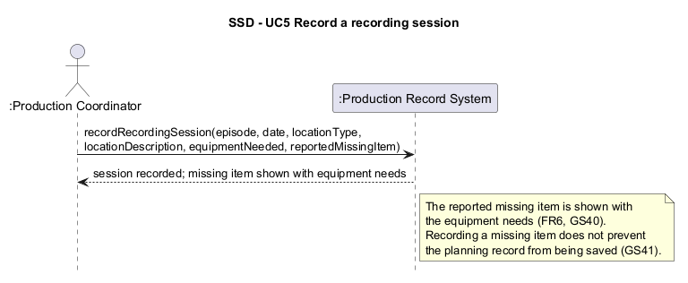

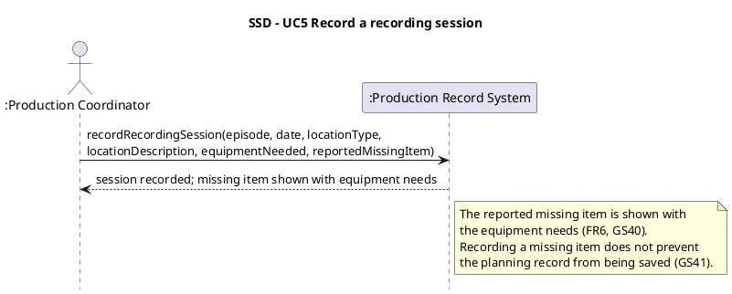

Alternative scenario: No item is reported missing.

| Actor | System |
|---|---|
| The production coordinator records the session date, location and required equipment without reporting a missing item. |  |
|  | The system records the session and shows its equipment needs without marking an item missing. |

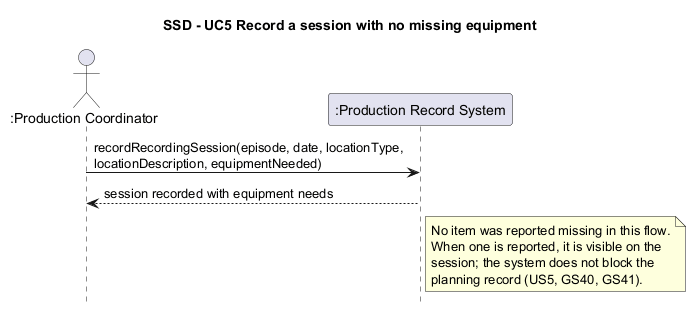

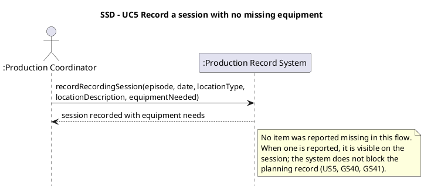

#### UC6: Record source recordings and draft versions

Use case: Record source recordings and draft versions; an approved draft is not assumed to be the version published (FR7).  
Primary actor: Technical volunteer.  
Goal: Record a session's files and mark which are usable (G6).

Main success scenario: Record several source files, link them to drafts, and show each draft's status (GS42–GS44).

| Actor | System |
|---|---|
| The technical volunteer records each source file from the session, including its working name and usability note. |  |
|  | The system records each SourceRecording against the session. |
| The technical volunteer records each draft for the episode and selects the source recordings it uses. |  |
|  | The system records each Draft and its source links. |
| The technical volunteer records the current status supplied by the authorised review process for each draft. |  |
|  | The system shows each draft with its linked sources and current status. |

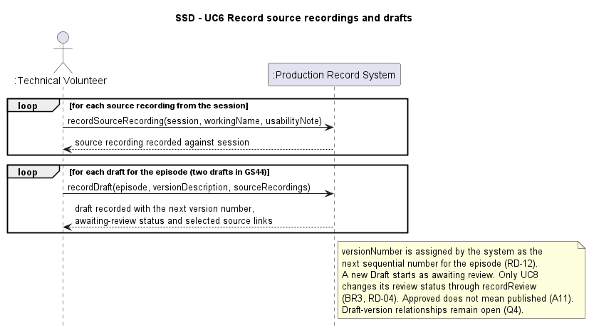

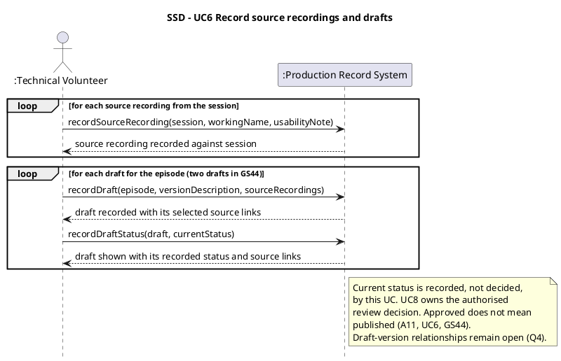

Alternative scenario: A draft has not been approved; its status remains visible and the system does not infer approval from another draft or from its sources.

| Actor | System |
|---|---|
| The technical volunteer records the current status "not approved" for a draft. |  |
|  | The system shows that draft as not approved and preserves its own source links. |

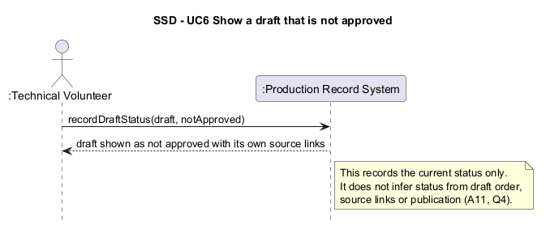

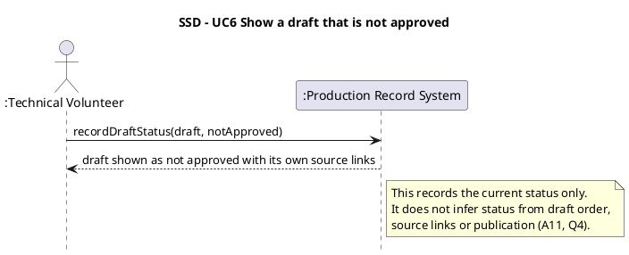

#### UC7: Record permissions for material used

Use case: Record permissions for material used (FR8).  
Primary actor: Technical editor.  
Goal: Record permissions for music, archive clips and external material (G7).

Main success scenario: Record granted permission for material used by a draft.

| Actor | System |
|---|---|
| The technical editor records the material description, source, permitted use, status and the draft or drafts that use it. |  |
|  | The system records the Permission against the selected draft or drafts and shows its granted status. |

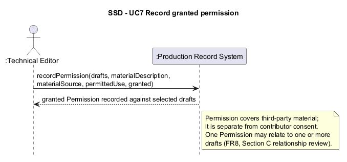

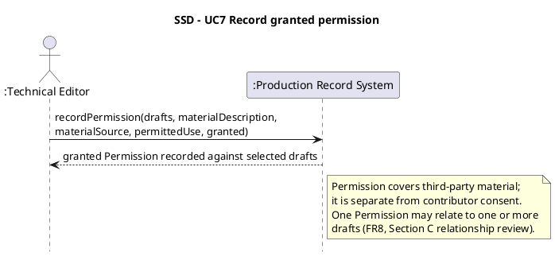

Alternative scenario: Record an outstanding permission and show it on the affected draft (GS45–GS46).

| Actor | System |
|---|---|
| The technical editor records the material and permitted use with status "outstanding", then views the draft's permissions. |  |
|  | The system records the Permission and identifies it as outstanding; the draft's other permission statuses remain visible. |

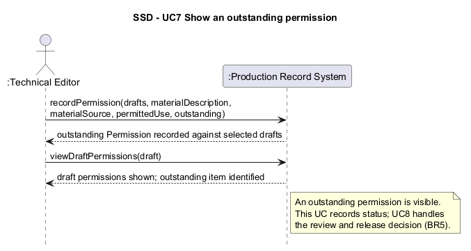

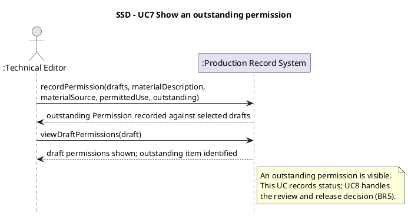

## Task #30 — Create CRC cards

### RecordingSession

- **Responsibilities:**
  - Know and Keep the session date and location.
  - Record the required equipment.
  - Record and show any reported missing equipment item.
  - Associate the session with one episode.
  - Keep links to the source recordings produced by the session.
- **Collaborators:** 
  - Episode
  - SourceRecording
  - EquipmentItem

### SourceRecording

- **Responsibilities:**
  - Know and keep the working filename and usability note.
  - Associate the recording with the recording session that produced it.
  - Keep links to the drafts that use the source recording
- **Collaborators:** 
  - RecordingSession 
  - Draft

### Draft

- **Responsibilities:**
  - Know and keep the draft desription and current status.
  - Associate the draft with its episode
  - Keep links to the source recordings used to make the draft
- **Collaborators:** 
  - Episode
  - SourceRecording
  - Permission

### Permission

- **Responsibilities:**
  - Know and keep the material description and source.
  - Record the permitted use.
  - Record the permission status as granted or outstanding.
  - Associate the permission with one or however many drafts that use the material.
  - Make an outstanding permission visible to the draft and rewiew workflow.
- **Collaborators:** 
  - Draft

## Summary

Section C covers UC5–UC7 and records recording sessions, source recordings, drafts and permissions. Missing equipment remains visible, drafts link to their source recordings, and outstanding permissions remain associated with the relevant draft. Publication review remains outside this section.